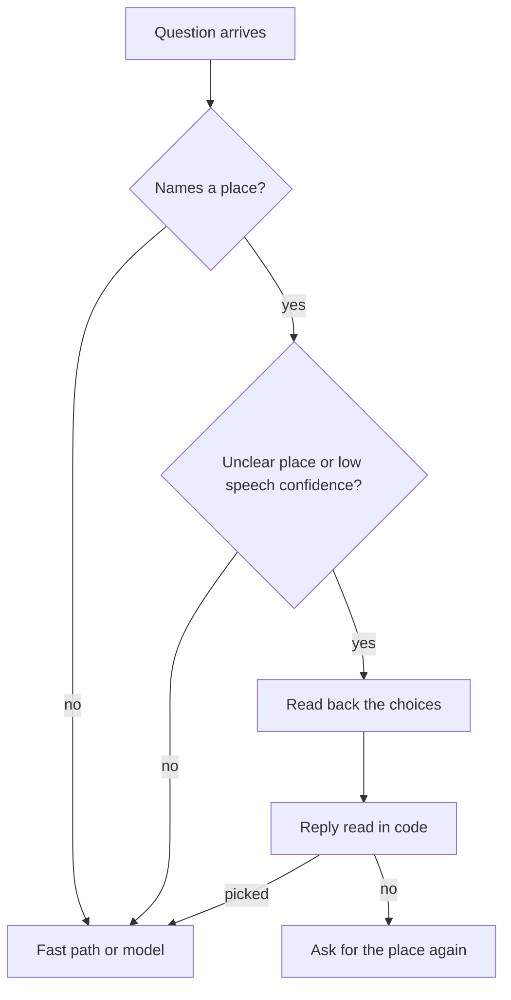

# Plan: bring the website copilot's safety features into the map agent

*Written 2026-10-31. Nothing here exists unless a line says **built**; everything else is a (proposal).*

## Problem
The map agent hands every question that the fast path cannot answer to one language model, and that model decides everything: which place was meant, whether the question is on topic, what to say, and when to act. When speech-to-text mishears "Bedford Park" as "Bedford", or a person says "86 St" (there are six stations with that name), the agent picks one in silence and draws a confident answer for the wrong place. The newcomer this app is for (`PROJECT.md`) cannot tell that it went wrong until they are on the wrong train.

The website copilot (a separate project, `chatbots/copilot-engine`, a step-by-step voice guide for forms and manuals) already solved this class of problem and proved it with test sets the code was never tuned on (holdout sets). Its rule: **code decides, the model only reads free text.**

## What the agent does today (read from the code on 2026-10-31)
1. The browser records a turn. The built-in recognizer is used where it works; otherwise the clip goes to `POST /api/stt` (`server/features/agent/stt.ts`), which calls Whisper on Groq and returns text. No confidence is kept.
2. The text goes to `POST /api/agent` (`server/features/agent/routes.ts`) with the earlier messages. The server keeps no conversation state.
3. Plain restroom, line, exit and trip asks are answered in code from the app's own feeds (`noModel.ts`, "the fast path").
4. Everything else goes to the main model (DeepSeek through InferHub) with tools. Places are resolved inside the `geocode` tool (`services.ts`): curated landmarks, then the first station whose name matches exactly, then OpenStreetMap shop names, then NYC GeoSearch.
5. The answer streams back with map commands and buttons; the browser speaks a short version (`src/lib/voice/tts.ts`).

## The features to port, in order

| # | Copilot feature | What it becomes here | Status |
|---|---|---|---|
| 1 | Read-back of hard identifiers, with spoken corrections | Before any answer, a place that matches several stations or landmarks, or only a near spelling, or that speech-to-text was unsure of, is read back: "Just to check: did you mean 86 St on the 1 train, …?" The reply ("the 1", "the second one", "yes", "no, Bedford Park") is read in code. A clear, unique match skips it, so most turns pay no extra wait. | **built** (first slice, below) |
| 2 | Code-decided rules, model reads free text only | Port the copilot's guard rules (`yesNo` with hedges and conditions, filler, "ask for a person") into `server/features/agent/guard.ts` and route every yes/no, choice and confirmation through them. The model never decides one. | **built** for yes/no (used by read-back); the rest (proposal) |
| 3 | Jev 1.14 on-topic gate before the main model | One cheap decisions call (about $0.00002 and 0.3 s in the copilot) asks "is this about getting around New York, the map, or city data?" before DeepSeek runs. Off-topic gets a fixed polite answer in code. Fast-path asks skip the gate. Key locked to Jev by an OpenRouter guardrail, as in the copilot. | (proposal) |
| 4 | Answers grounded only in retrieved rows | The existing answer audit (`audit.ts`, "no guessing" check) already flags numbers that did not come from a tool. Make it blocking: a figure, station or time not found in a tool result is replaced by "I don't know" plus the button that shows the data. Same check for the street-view and 311 answers. | (proposal) |
| 5 | Confirm card before any side effect | The agent has few side effects today (it draws on the map). The first real ones are saving Home or Work, starting a reminder and sharing a trip. Each goes through a card ("Save 350 5 Av as Home? Yes / Change"), and only a clear yes from `guard.ts` acts. Never on silence, "maybe", or "yes but". | (proposal) |
| 6 | Holdout sets plus a ledger | `tests/holdout/*.json`: questions written before the code they test, run against the real pipeline, each result appended to `ledger.jsonl` (set, model, prompt version, pass). A holdout that has been used to fix code is retired and a fresh one written, as the copilot does. | (proposal) |

### The read-back flow (feature 1)

Diagram

The same steps as a list:
1. A question arrives (typed or spoken).
2. If it names a place (a trip "from … to …" or an exit "for …"), the place is scored against the curated landmarks and every subway station name.
3. Read back only when: two or more places match exactly (six "86 St" stations), or nothing matches exactly but something is close ("Grand Centrl"), or speech-to-text confidence for that turn was below 0.6.
4. The reply is read in code: an ordinal ("the second one"), a train ("the 1"), a word only one choice has ("Lehman"), a plain yes when there was one choice, or "no, <another place>".
5. A pick rewrites the question with the exact place ("86 St (1 train)"), which the station matcher now resolves to that station, and the normal flow continues. A bare "no" asks for the place again.

The server stays stateless: on the next turn it rebuilds the same read-back question from the earlier message and only treats the reply as an answer if the question in the history matches word for word. A reply that is really a new question (it has a question mark, more than eight words, or is itself a plain ask) drops the read-back.

## Shared voice model host (proposal)
Both agents (this one and the copilot) need speech-to-text and text-to-speech. Today this app rents Whisper on Groq per clip and the browser speaks; the copilot plans its own Whisper and ElevenLabs. Loading the same models twice wastes the one GPU host and doubles the work.

Proposal: one small speech service, run on the MacBook Pro (the deploy machine), that both apps call.
- **Interface.** Two streaming endpoints that LiveKit Agents (the recorded voice stack) can use as its speech plugins: `stt` takes 16 kHz audio frames over a WebSocket and streams partial and final text with a confidence per final segment; `tts` takes text and streams audio chunks as they are made. One HTTP fallback each (`POST /v1/audio/transcriptions`, `POST /v1/audio/speech`, OpenAI-shaped), so this app's existing `STT_BASE_URL` setting can point at it with no code change.
- **Models.** Open speech models only, loaded once: a Whisper-family model for many languages (the newcomer may not speak English) and an open text-to-speech model with voices for the app's languages. The exact pick is a bake-off on the holdout audio (word error rate on NYC street and station names, first-audio latency), not chosen here.
- **Short-wait batching.** Requests are queued; the worker runs a batch when it is full or when the oldest request has waited 10-30 ms (start at 20 ms, tune by measuring). When several people talk at once their audio shares one GPU pass; a lone speaker waits at most the window.
- **Streaming.** Speech-to-text runs on short chunks with a voice-activity detector so partial text arrives while the person is still talking; text-to-speech starts speaking the first sentence while the rest is still being made.
- **Confidence out.** Every final transcript carries a 0-1 confidence (mean per-token probability), which feeds the read-back trigger above.
- **Tenants and limits.** Each app has its own key and per-minute cap, so a busy copilot cannot starve the map agent. Audio is never stored or logged (same rule as `stt.ts` today).
- **Fallback.** If the host is down, this app falls back to Groq Whisper and browser speech, as now.
- **Dev and tests** on the Windows RTX 4060 laptop; it is never a deploy target.

## What is left, in order
1. Send the speech-to-text confidence from the browser with each spoken turn (`useSpeech.ts` and `serverStt.ts` → `heard.confidence` in the agent request). The server side accepts and uses it (**built**); the browser does not send it yet.
2. Read back places the model resolves too (inside the `geocode` tool), not only plain trip and exit asks; read back the second place of a trip when both are unclear (today only the first unclear place is asked).
3. Say the borough in read-backs ("Bedford Park Blvd in the Bronx"); stations carry no borough field yet.
4. Guard rules for the rest of the agent (feature 2), then the Jev gate (3), blocking grounding (4), confirm cards (5).
5. A first holdout set of 30 spoken and typed place questions written before more read-back changes, plus the ledger (6).
6. The shared speech host: bake-off, then the service, then point both apps at it.
