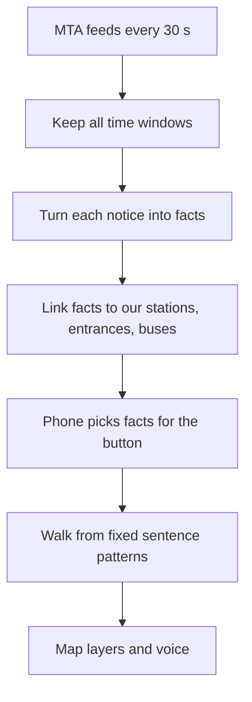

# Plan: notice walks that tell a rider what to do

Written 2026-11-27. Status: a proposal the owner asked for after approving the preview. Nothing in it is built unless the text says so.

## Where we start from

On Thanksgiving night the 7 line's notice said "Flushing-bound 7 trains skip 52 Street and 69 Street" and then "When: Through Spring 2027." The MTA's own text also said that this weekend the 7 skips 74 St-Broadway and four more stops. The walk dropped that line. A rider heading to 74 St on Saturday would have heard that everything was fine.

That is one of several gaps a feed audit on 2026-11-25 and two more checks on 2026-11-26 and 2026-11-27 found in how the line panel turns an MTA notice into a spoken walk:

1. The server keeps one time window per notice. `slimAlert` in `server/features/transit/alerts.ts` takes the first matching `active_period` and drops the rest. The 74 St-Broadway notice has 227 windows; the walk reads one.
2. Upcoming elevator outages are thrown away (`isupcomingoutage !== "Y"` in `server/features/transit/routes.ts`), and the planned-work window request returns no outages at all. So the Weekend buttons can never show an elevator that will be out this weekend.
3. Advice is read only in one wording. `transfers()` in `src/features/transit/alertDiagram.ts` expects "For service to these stations". Of 78 skip notices on 2026-11-27, 14 give advice per station instead ("For service to Sutphin Blvd, take..."), and the walk loses it.
4. Every walk ends with "Why: we're replacing tracks." The owner judged that low value next to clear guidance (2026-11-26). 170 of the 173 notices carry such a reason.
5. The rest of the MTA text hides behind a Full notice button, and the walk lists every case at once (going to, leaving, the other direction), so a rider cannot tell which one is theirs.
6. Elevator outages have no walk at all. Yankee Stadium had two broken elevators with different detours, shown as one block of text.

## What the owner approved

The preview is `docs/design/notice-walks-preview.html` (open it in a browser; it plays real notices from Thanksgiving week). The same page is published as a private artifact the owner can share. It settled these rules:

- Four small buttons on one row: Day, Night, Weekend day, Weekend night. The one for the current New York time is already picked. 6 AM and 9 PM split day and night; Friday 9 PM to Monday 6 AM is the weekend.
- Tapping a notice tells everything, read aloud. There is no Full notice button; the MTA's own words sit behind (i).
- Each step says what to do and where. No reasons.
- The rider says their situation first: their stop, and whether they are getting off or getting on there. Only that case plays, one action per step. Step one also says who is not affected.
- The map shows everything a step names: stations, the two tracks with the skipping side crossed out, which way each track runs, the train and which way it is going, where to cross platforms, the bus route and its stop, the walk, the elevator entrance that is out and the one to use instead.
- An elevator walk starts with what is broken, then "if you can use the stairs, nothing changes," then the step-free way, which starts where the rider actually is.
- Where our data lacks something (an elevator entrance, a bus route), the walk says so instead of guessing.

An audit run on the preview checked 952 steps, every notice, time button, stop and trip choice, and found nothing named in a step that the map did not show.

## How it will work

1. The server reads the MTA service alerts and the elevator feed every 30 seconds, as it does now, and keeps every time window and the upcoming outages.
2. It turns each notice into facts: which line and direction, which stops are skipped or closed, where to change in each direction and for each stop, which buses from which corners, which elevator, and when. Rules do this, not a model.
3. It links each fact to our data: station ids, elevator and stair entrances, bus route shapes. It merges notices that overlap in the same window and drops ones the MTA has paused (the Burnside Av skip, lifted for Nov 27 to 30).
4. The phone takes the facts for the chosen button and builds the walk from fixed sentence patterns ("Stay on to the next stop, {station}"), then draws it.
5. The sentence patterns are translated once per app language, checked, and shipped with the app, so a walk in Spanish or Bengali needs no call and works offline. Kokoro reads English, Spanish, French and Chinese; the phone's own voice reads the rest.

### Where AI helps, and where it does not

The rider-facing words never come from a model on the fly. A model helps in three places:

- When a notice matches no rule, a model reads the MTA text and proposes facts. Code checks every station, line and direction against our data before using them. If the check fails, the rider sees the MTA text, translated, and the notice is flagged for a new rule.
- It translates the sentence patterns ahead of time, for review before release, and the MTA text of notices we cannot turn into a walk.
- A nightly check runs the coverage audit over all live notices and reports any that fell back to text, so a change in MTA wording shows up as a report rather than a broken walk.

## The work, one pull request each

Each piece lands on its own, with tests built from the real notices the audits saved. Any change to a screen adds or updates an `expectLayout` case in `e2e/responsive.spec.ts`, as `AGENTS.md` requires.

1. Keep every time window and upcoming outages. Change `slimAlert` to carry all windows and the window request to include outages. Done when the 74 St-Broadway notice reports its weekend windows and a test pins the Saturday skip.
2. Notice facts. A parser for the patterns the audit counted: skipped stops (78), no trains with shuttle or another line (35), boarding from another platform (16), fewer or slower trains (16), extra stops, reroutes, another line instead, split line, entrance closures, special schedules. It reads advice in both wordings and keeps per-direction and per-stop changes. A small alias list covers name differences ("Woodside-61 St" and "61 St-Woodside", "Heights" and "Hts"). Done when the coverage script turns at least 165 of the 173 saved notices into facts and lists the rest.
3. The walk builder. Replace the steps in `alertDiagram.ts` with walks built from facts and sentence patterns: the trip choice, one action per step, no Why step, the MTA words behind (i). Done when every saved notice produces a walk whose steps pass the same audit the preview passed. The same walk opens when a rider taps a crossed-out station on the map: the old "Skipped · 52 St" card ("Skipped Flushing-bound · Manhattan-bound stops", a list of stops, "Through Spring 2027") goes, replaced by that station's notice walk (owner, 2026-11-27).
4. Map layers. Two tracks with direction arrows, signposts beside their own track, the train's direction tag, change markers, closed stretches, bus routes and stops from our bus data, shuttle stops from the MTA's per-station corners, walking lines, and labels that name the line when two stations share a name. Done when the layout bar passes at all four sizes with a notice open.
5. The four time buttons. Replace Now and This weekend in `LinePanel.tsx` and `src/lib/transit/lineDay.ts`. Done when the button for the current New York time is picked on open and each button shows only what applies then.
6. Elevator walks. Match each outage to its entrance using the corner the MTA names and the corner `entranceLabels.ts` works out from the map; tell street elevators from ones inside the station; build each detour from the MTA text, with the journeys "To the street", "To the B or D" and so on; mark the working elevator at the station the detour uses. Done when all 14 elevator outages from 2026-11-27 open a walk, and the 10 that name a corner or street pin the right entrance.
7. Translation and voice. Ship translated sentence patterns for the eight app languages. Pick the best voice the phone has (Enhanced, Premium or Natural, offline first). Where the phone has no voice for the language, show the text and say so. Add "App voice" or "My phone's voice" to the voice settings.
8. The model as helper and the nightly report, as described above.

## Data gaps to close

- Our station data has no elevator entrance for Mosholu Pkwy, Grand Central-42 St, 149 St-Grand Concourse (the 4), 49 St and Fulton St, though the MTA lists elevators or outages there.
- Two stations have two elevator entrances (231 St, 61 St-Woodside), so the corner match in step 6 decides which is out.
- We have no Metro-North stations. The Yankee Stadium detour sends Reduced-Fare riders to Yankees-E 153 St; the preview places it by estimate.
- Our bus data names the M14 as M14A+ and M14D+, so "M14" in a notice needs a match. Temporary shuttles (B109, Bx91, L92) exist only during the work, so they are drawn from the MTA's stop corners.
- Escalator outages come with no MTA detour (15 on 2026-11-26). One line is enough: use the stairs or the elevator.

## Decisions for the owner

1. Should the Weekend buttons also list next weekend's notices under their own heading, as the preview does for the 4's Dec 4 to 7 shutdown, or show this weekend only?
2. The preview picks the nearest D stop by straight-line distance and estimates walking minutes. Keep that, labelled approximate, or use real walking routes?
3. Should the app voice or the phone's voice be the default for languages both can speak?

## Not in this plan

Trip planning across lines, bus delays, and pushing notices to the phone. Speech routing stays in `voice-agent-research`, as `AGENTS.md` says.
