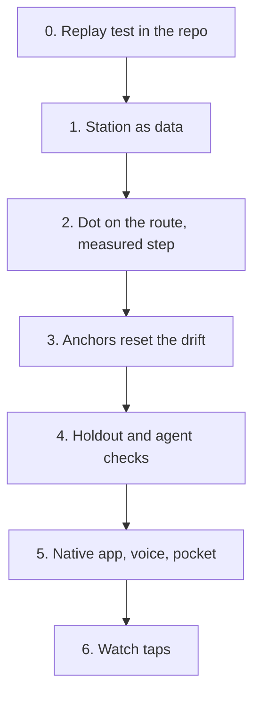

# Plan: guiding a rider through a station without GPS

Written 2026-11-20. Status: a proposal. Nothing in it is built unless the text says so.

## Where we start from

On 2026-11-13 we recorded a walk through 14 St-Union Sq: platform, elevator, mezzanine, second elevator, street. Replaying that recording with GPS withheld, the dot that follows the rider ends about 63 metres past the second elevator. The rider took 296 steps across a mezzanine route the map measures at about 144 metres, and the guide assumes every step is 0.7 metres.

Two things came out of that replay.

1. Step count along the mapped route is usable. If the step length is measured on the platform leg first (231 steps over about 130 metres, so 0.56 metres a step), the overshoot at the second elevator falls from 63 metres to about 23. That is a drift of 16% of the distance walked, against 44% with the fixed step.
2. The phone's direction is not usable on this recording. Leg by leg, the gap between the direction the phone reported and the direction the route runs moved between +54 and −147 degrees, most likely because the phone was held up to film. A dot that moves freely by steps and heading was 27 metres off on average with the elevators as its only fixed points, and adding a fixed point at every sign made the worst case 117 metres, because each correction was followed by a badly aimed leg.

So the guide should keep the dot on the mapped route, measure the rider's step, and reset the drift whenever it recognises a known spot.

These numbers come from one recording and a one-off script that is not in the repository yet. The mezzanine sign times in that recording are estimates, so only the figures at the two elevators are measured against something we know for certain.

## What other cities did

The research is in `docs/presenter/qa/research.json` and in two documents in the project's Octo database. In short: Washington and Singapore use Waymap, which pairs phone motion with mapped walking routes and needs no station hardware. Tokyo's Toei Subway uses camera arrows at Tochomae. Seoul's app gives exit and platform directions without saying how it positions the rider. London trialled Bluetooth beacons at Euston. New York's own transit agency, the MTA, installs NaviLens codes, which a phone camera reads from a distance; its page (updated 2025-09-11) lists them at 50 stations in Manhattan and the Bronx, including both halves of 14 St-Union Sq.

We follow Washington for the core and Tokyo for corrections. The owner spoke with the NaviLens team on or before 2026-11-20 and they offered to help.

## The plan

The same steps as a list, with what "done" means for each.

| Step | What gets built | Done when |
| --- | --- | --- |
| 0. Replay test | The one-off simulation becomes a test that runs on every recording we hold | The 63 m and 23 m figures are reproduced by a command in `package.json` |
| 1. Station as data | Levels, paths and checkpoints in one standard format, stored in the database | The filmed Cortlandt St to Union Sq route can be rebuilt from the data alone |
| 2. Position | The dot moves along the route by steps, with the step length measured between the first two known points | Drift at the far elevator is under 25 m on recordings the settings were not tuned on |
| 3. Anchors | A read sign, a NaviLens code, an elevator ride or a tap all do one thing: put the dot on a checkpoint | Drift before each correction stays under about 12 m; the sign reader never names the wrong checkpoint on held-out frames |
| 4. Validation | The hidden holdout and the agent checks described below | The checks run in CI and report totals only |
| 5. Native app | Phone in a pocket, spoken turns, barometer | The step 2 and 3 numbers hold on pocket-carried recordings |
| 6. Watch | A tap on the wrist for each instruction | The tap fires within a few steps of the checkpoint in replay |

Steps 2 and 3 touch the same code and should be built together. Step 5 needs the Apple Developer account that the barometer app on issue #223 (the remaining recorder work) is already waiting on. Step 6 only repeats what the phone knows, so it waits until the position is trustworthy.

## How it is checked

Five methods, each covering what the others miss.

### The product document and specifications

`docs/PDD.md` is the product design document: what is built, what remains, how to check and ship. Its section "Rider walks: the second half of the product" lists the walk guide and the clean-up. This plan belongs there as the next rows of that table, with a link to this file.

Each step then gets a specification in `docs/specs/` before any code, written the way `docs/specs/RECORDER_CONTRIBUTIONS.md` already is: the behaviour in plain words, and contract tests that exist from the start and switch on as each piece lands (pull request 224 does this for the recorder). The specification names the numbers in the table above, so "done" is a test result.

### Replay

Every recorded walk is a test case. Its sensor rows go through the guide and the error is measured at points we know for certain: elevator rides found by the barometer, and street-level location fixes with an accuracy of 20 metres or better. This is what produced the figures at the top.

### Metamorphic tests

Underground we rarely know where the rider truly was, so most of a recording cannot be scored against the truth. A metamorphic test gets round that: change the input in a way whose effect on the output is known, and check the output moved as it should. None of these needs a true position.

| Change to the input | What must hold |
| --- | --- |
| Stretch the time between steps (a slower walk, same steps) | The dot ends in the same place |
| Turn the whole heading record by a fixed angle | The dot on the route does not move |
| Double the step count and halve the measured step | Same path |
| Drop one step row in ten | The end point moves by no more than a tenth of the distance |
| Add location fixes with poor accuracy while underground | Nothing changes |
| Add an anchor at a checkpoint | Error at that checkpoint is zero, and no later error grows |
| Remove an anchor | Error after it does not shrink |
| Play the walk backwards along the route | Progress mirrors the forward walk |
| Dim, crop or slightly blur a sign frame | The sign reader gives the same checkpoint or no answer, never a different checkpoint |
| Add a sign that is not on the route to the list of candidates | The reader's answer for route signs is unchanged |

A failed relation is a bug even when the replay numbers look good. The anchor rows would have caught the 117-metre case above before any walk was needed.

### Hidden holdout

Numbers tuned on a recording look good on that recording. The line-status evaluation in `docs/eval/line-status/PROGRAM.md` already handles this with a rule: keep a change when the score on the training cases rises by at least 3 points and the score on held-out cases falls by no more than 3. The walk guide needs the same split, with one addition: the held-out recordings and sign frames stay out of the repository.

- They live in the Octo database or a CI secret store, readable only by the CI job.
- The job prints totals (drift at known points, wrong-checkpoint count), never the cases.
- Whoever builds the guide, a person or an agent, never opens them. A builder who sees which case failed starts fitting to it.
- Scoring runs are counted. After a set number of runs against the same holdout it is treated as seen, and new recordings replace it.

Today there is one usable Union Sq recording, plus a filmed transfer at 74 St-Broadway on pull request 237. That is too few to split. Until there are at least three walks per station, holdout results are a warning light and the metamorphic tests carry the weight.

### Agents as testers, and agents being tested

AI agents take three separate jobs here.

As riders. An agent is given only what a rider gets: the instruction text and the picture at each checkpoint. It moves a body through the 3D station (the Fulton St model already has a simulated walker in `src/lib/map/three/stationWalk.sim.test.ts`) and must reach the exit. If it turns the wrong way at a checkpoint, the instruction there is unclear. Running it with a deliberately wrong start, or with one sign missing, tests whether "lost, scan a sign" recovers.

As adversaries. A second agent's job is to break the guide: it writes altered recordings and sign frames and reports any that violate a metamorphic relation. It is paid in failures found.

As the thing under test. The chat agent answers questions about stations ("which elevator reaches the L?"). Issue #186, the rider-walks loop, says each cleaned walk is a dataset those answers are checked against, and that no comparison run has been made. The station data from step 1 becomes that answer key.

Two rules keep this honest. The agent that builds a change is never the agent that judges it, and the judge sees the result without the builder's notes. And no agent result replaces a person walking the route once: an agent can show the instructions are followable in a model of the station, which is a weaker claim than a rider following them in the station.

## Standards and libraries

| Tool | Use | Verdict |
| --- | --- | --- |
| GTFS Pathways and Levels, the transit standard for station interiors (nodes, walkways, stairs, elevators, fare gates, levels, sign text) | The format for step 1 | Adopt. Our checkpoints map onto it almost one to one |
| OpenTripPlanner, the open trip planner noted in `docs/OTP.md` | Step-free routing through a station from Pathways data | Use to check step 1: it should find the route we filmed |
| pgvector, already installed in the Octo database (version 0.8.7) | Matching read sign text or a photo to a checkpoint | Try in step 3 |
| PostGIS, the spatial extension for Postgres | Nearest checkpoint on a level | Not available in Octo (checked 2026-11-20: only `plpgsql` and `vector`). Plain longitude, latitude and level columns are enough at this size |
| IMDF, Apple's indoor map format, and ARKit | Indoor positioning in a native app | Later, with step 5 |
| OpenStreetMap indoor tagging | A source for levels and elevators | Check per station |
| IndoorGML, matching camera frames against a 3D model | | Not now |

The MTA released a draft Pathways dataset for 106 stations and complexes. We have not opened it, so we do not know whether it covers our stations, how detailed it is, or whether it is current. Checking it is the first task of step 1, because it decides how much of the station data we get without recording.

## What we do not know

- Whether the 16% drift holds for other riders, a phone in a pocket, or a crowded station.
- Where the NaviLens codes at Union Sq are and what they say. Ten stills from our film show none, and the full video has not been searched.
- Whether NaviLens's reader can run inside a web page or needs a native app.
- Whether steps counted from the accelerometer (pull request 230) behave better than the phone's own pedometer.

## First moves

1. Land the replay simulation as a test (step 0), with the metamorphic rows that need no new data.
2. Open the MTA's draft Pathways dataset and report what it holds for Union Sq, Cortlandt St and Fulton St.
3. Send NaviLens two requests: the Union Sq code list with positions and text, and whether their reader runs in a web app.
4. Write the specification for steps 2 and 3 with their contract tests.

Sources: [MTA, accessible wayfinding through NaviLens](https://www.mta.info/accessibility/innovations/navilens); [MTA developer group, draft GTFS-Pathways announcement](https://groups.google.com/g/mtadeveloperresources/c/j-vVGirkKkc); [GTFS Pathways](https://gtfs.org/getting-started/features/pathways/); [Waymap, WMATA case study](https://www.waymapnav.com/case-studies/wmata-washington-metro); [FloorPair study](https://www.mdpi.com/1424-8220/19/16/3622).
