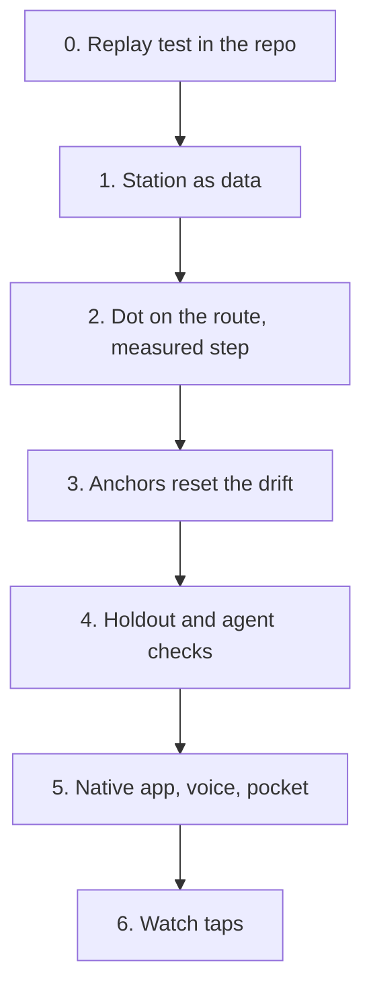

# Plan: guiding a rider through a station without GPS

Written 2026-11-20. Status: a proposal. Nothing in it is built unless the text says so.

## Where we start from

On 2026-11-13 we recorded a walk through 14 St-Union Sq: platform, elevator, mezzanine, second elevator, street. Replaying that recording with GPS withheld, the dot that follows the rider ends about 63 metres past the second elevator. The rider took 296 steps across a mezzanine route the map measures at about 144 metres, and the guide assumes every step is 0.7 metres.

Two things came out of that replay.

1. Step count along the mapped route is usable. If the step length is measured on the platform leg first (231 steps over about 130 metres, so 0.56 metres a step), the overshoot at the second elevator falls from 63 metres to about 23. That is a drift of 16% of the distance walked, against 44% with the fixed step.
2. The phone's direction is not usable on this recording. Leg by leg, the gap between the direction the phone reported and the direction the route runs moved between +54 and −147 degrees, most likely because the phone was held up to film. A dot that moves freely by steps and heading was 27 metres off on average with the elevators as its only fixed points, and adding a fixed point at every sign made the worst case 117 metres, because each correction was followed by a badly aimed leg.

So the dot belongs on the mapped route, moved by steps and reset whenever the guide recognises a known spot.

The Walk Guide already works that way (`src/features/walkguide/progress.ts`). Its dot is the last checkpoint the rider confirmed, by tapping a sign or having the camera read it, plus the steps counted since, laid along the line to the next checkpoint and never past it. A confirmed sign puts the dot back exactly. What it lacks:

- It counts in its own steps. The guide says 212 steps between the two elevators and this rider took 296, which is 40% more; on the platform the gap was 5% (231 against 220). So the guide says "the sign should be in view" early, by a different amount on each stretch, and it has no way to learn a rider's step.
- Only a tapped or camera-read sign resets it. An elevator ride, which the barometer can detect, and a NaviLens code do not.
- Nothing measured any of this on a recording until now.

These numbers come from one recording. The step counts and distances are now pinned by a test (`src/features/recorder/clean/metamorphic.test.ts`, pull request 256); the free-moving dot's 27 and 117 metres came from a one-off script that is not in the repository. The mezzanine sign times in that recording are estimates, so only the figures at the two elevators are measured against something we know for certain.

Three sources disagree about the mezzanine, and that limits how much to read into the step-length gain. The map says about 144 metres. The guide's 212 steps would make a step 0.68 metres there, against 0.59 on the platform. The rider's 296 steps make it 0.49. Measuring the step on the platform closes most of the gap if the map's distances are right (63 metres down to 23) and little of it if the guide's step counts are right (the guide would be 28% early, against 25% after scaling by the platform's 5%). Which is right needs a second recording.

## What other cities did

The research is in `docs/presenter/qa/research.json` and in two documents in the project's Octo database. In short: Washington and Singapore use Waymap, which pairs phone motion with mapped walking routes and needs no station hardware. Tokyo's Toei Subway uses camera arrows at Tochomae. Seoul's app gives exit and platform directions without saying how it positions the rider. London trialled Bluetooth beacons at Euston. New York's own transit agency, the MTA, installs NaviLens codes, which a phone camera reads from a distance; its page (updated 2025-09-11) lists them at 50 stations in Manhattan and the Bronx, including both halves of 14 St-Union Sq.

We follow Washington for the core and Tokyo for corrections. The owner spoke with the NaviLens team on or before 2026-11-20 and they offered to help.

## The plan

The same steps as a list, with what "done" means for each.

| Step | What gets built | Done when |
| --- | --- | --- |
| 0. Replay test | Checks on the real recording that need no true position | Done for the first set in pull request 256. The first test written found that the cleaned path moved by up to 21 m with the phone's compass frame, now fixed |
| 1. Station as data | Levels, paths and checkpoints in one standard format, stored in a PostGIS database (PostGIS is the spatial extension for Postgres) | The filmed Cortlandt St to Union Sq route can be rebuilt from the data alone, and "nearest checkpoint on this level" is one query |
| 2. Position | The Walk Guide's dot learns the rider's step: the ratio of steps taken to steps the guide counted, measured between confirmed checkpoints and applied to the next stretch | Drift at the far elevator is under 25 m on recordings the settings were not tuned on |
| 3. Anchors | An elevator ride found by the barometer and a NaviLens code reset the dot the way a tapped or camera-read sign already does | Drift before each correction stays under about 12 m; the sign reader never names the wrong checkpoint on held-out frames |
| 4. Validation | The hidden holdout and the agent checks described below | The checks run in CI and report totals only |
| 5. Native app | Phone in a pocket, spoken turns, barometer | The step 2 and 3 numbers hold on pocket-carried recordings |
| 6. Watch | A tap on the wrist for each instruction | The tap fires within a few steps of the checkpoint in replay |

Steps 2 and 3 touch the same code and should be built together. Step 5 needs the Apple Developer account that the barometer app on issue #223 (the remaining recorder work) is already waiting on. Step 6 only repeats what the phone knows, so it waits until the position is trustworthy.

## How it is checked

Five methods, each covering what the others miss.

### The product document and specifications

`docs/PDD.md` is the product design document: what is built, what remains, how to check and ship. Its section "Rider walks: the second half of the product" lists the walk guide and the clean-up. This plan belongs there as the next rows of that table, with a link to this file.

Each step then gets a specification in `docs/specs/` before any code, written the way `docs/specs/RECORDER_CONTRIBUTIONS.md` already is: the behaviour in plain words, and contract tests that exist from the start and switch on as each piece lands (pull request 224 does this for the recorder). The specification names the numbers in the table above, so "done" is a test result.

### Replay

Every recorded walk is a test case. Its sensor rows go through the guide and the error is measured at points we know for certain: elevator rides found by the barometer, and street-level location fixes with an accuracy of 20 metres or better. This is what produced the figures at the top.

### Metamorphic tests

Underground we rarely know where the rider truly was, so most of a recording cannot be scored against the truth. A metamorphic test gets round that: change the input in a way whose effect on the output is known, and check the output moved as it should. None of these needs a true position.

| Change to the input | What must hold |
| --- | --- |
| Stretch the time between steps (a slower walk, same steps) | The dot ends in the same place |
| Turn the whole heading record by a fixed angle | The dot on the route does not move |
| Double the step count and halve the measured step | Same path |
| Drop one step row in ten | The end point moves by no more than a tenth of the distance |
| Add location fixes with poor accuracy while underground | Nothing changes |
| Add an anchor at a checkpoint | Error at that checkpoint is zero, and no later error grows |
| Remove an anchor | Error after it does not shrink |
| Play the walk backwards along the route | Progress mirrors the forward walk |
| Dim, crop or slightly blur a sign frame | The sign reader gives the same checkpoint or no answer, never a different checkpoint |
| Add a sign that is not on the route to the list of candidates | The reader's answer for route signs is unchanged |

A failed relation is a bug even when the replay numbers look good. The anchor rows would have caught the 117-metre case above before any walk was needed.

### Hidden holdout

Numbers tuned on a recording look good on that recording. The line-status evaluation in `docs/eval/line-status/PROGRAM.md` already handles this with a rule: keep a change when the score on the training cases rises by at least 3 points and the score on held-out cases falls by no more than 3. The walk guide needs the same split, with one addition: the held-out recordings and sign frames stay out of the repository.

- They live in the Octo database or a CI secret store, readable only by the CI job.
- The job prints totals (drift at known points, wrong-checkpoint count), never the cases.
- Whoever builds the guide, a person or an agent, never opens them. A builder who sees which case failed starts fitting to it.
- Scoring runs are counted. After a set number of runs against the same holdout it is treated as seen, and new recordings replace it.

Today there is one usable Union Sq recording, plus a filmed transfer at 74 St-Broadway on pull request 237. That is too few to split. Until there are at least three walks per station, holdout results are a warning light and the metamorphic tests carry the weight.

### Agents as testers, and agents being tested

AI agents take three separate jobs here.

As riders. An agent is given only what a rider gets: the instruction text and the picture at each checkpoint. It moves a body through the 3D station (the Fulton St model already has a simulated walker in `src/lib/map/three/stationWalk.sim.test.ts`) and must reach the exit. If it turns the wrong way at a checkpoint, the instruction there is unclear. Running it with a deliberately wrong start, or with one sign missing, tests whether "lost, scan a sign" recovers.

As adversaries. A second agent's job is to break the guide: it writes altered recordings and sign frames and reports any that violate a metamorphic relation. It is paid in failures found.

As the thing under test. The chat agent answers questions about stations ("which elevator reaches the L?"). Issue #186, the rider-walks loop, says each cleaned walk is a dataset those answers are checked against, and that no comparison run has been made. The station data from step 1 becomes that answer key.

Two rules keep this honest. The agent that builds a change is never the agent that judges it, and the judge sees the result without the builder's notes. And no agent result replaces a person walking the route once: an agent can show the instructions are followable in a model of the station, which is a weaker claim than a rider following them in the station.

## Standards and libraries

| Tool | Use | Verdict |
| --- | --- | --- |
| GTFS Pathways and Levels, the transit standard for station interiors (nodes, walkways, stairs, elevators, fare gates, levels, sign text) | The format for step 1 | Adopt. Our checkpoints map onto it almost one to one |
| OpenTripPlanner, the open trip planner noted in `docs/OTP.md` | Step-free routing through a station from Pathways data | Use to check step 1: it should find the route we filmed |
| pgvector, already installed in the Octo database (version 0.8.7) | Matching read sign text or a photo to a checkpoint | Try in step 3 |
| PostGIS, the spatial extension for Postgres | Where station data lives: checkpoints as points, paths as lines, each with its level. Nearest checkpoint, distance along a path and snapping a point to the route become queries | Adopt (owner, 2026-11-20), in its own database beside the app, see below |
| IMDF, Apple's indoor map format, and ARKit | Indoor positioning in a native app | Later, with step 5 |
| OpenStreetMap indoor tagging | A source for levels and elevators | Check per station |
| IndoorGML, matching camera frames against a 3D model | | Not now |

PostGIS is not in the Octo database: on 2026-11-20 that server (PostgreSQL 16.15) listed two installed extensions, `plpgsql` and `vector`, and offered no others. The other projects on Octo do not need PostGIS, so station data gets its own database. Pull request 255 adds a Postgres 16 with PostGIS as the container `nyc-map-postgis` in the app's own compose project on the VPS, deployed by Komodo like the rest of the app. It has a database called `stations`, publishes no port, and nothing reads it yet; `deploy/README.md` says where its data and password live. The app's other data stays in Octo.

The MTA's own station-interior data is old and marked not for public use. Its two current subway schedule feeds, downloaded on 2026-11-20, hold no `pathways.txt` or `levels.txt`. The Pathways data is a separate draft that New York City Transit announced on 2020-05-26: 106 stations and complexes, with elevators and escalators carrying the same identifiers as the live outage feed. The announcement asks developers not to use the draft in public-facing applications, says its entrance and mezzanine names are not final, and notes that every station is modelled with one northbound and one southbound platform. A developer asked for an update in 2022 and the thread shows no reply. The files sit in a shared Google Drive folder linked from the announcement.

We opened the feed on 2026-11-20 (its files are dated 2021-10-11, so it was updated after the announcement). It holds 3,810 pathways across 230 station entries: 2,044 stairs, 401 elevators, 264 escalators, 231 walkways and 870 fare and exit gates. 3,307 of them carry the sign a rider sees.

Asked for a route with no stairs or escalators, it gives back the two routes we filmed, with the same elevators and the same signs:

| Our filmed route | The draft's route |
| --- | --- |
| Union Sq, uptown N/Q/R/W platform to the street | Elevator EL219 ("Elevator to Mezzanine"), a walkway signed "Exit 14 St, 4 5 6, Elevator to L", the exit gate signed "Exit 14 St & 4 Av", then elevator EL217 to the north-east corner |
| Cortlandt St, the Broadway and Dey St elevator to the uptown R/W platform | Elevator EL728X down to the lower concourse, a walkway signed "WTC/PATH", the fare gate, then elevator EL727X ("Elevator to Uptown & Queens") |

What it lacks is position. Only the 985 street entrances have coordinates; the 844 points inside stations (mezzanines, gates, landings) have none. There is no levels file and no length or walking time on any pathway. One entrance coordinate is plainly wrong (a WTC Cortlandt entrance placed in upper Manhattan).

So the two fit together. The draft knows how a station connects and what the signs say, for 230 stations, and does not know where anything is or how far apart. A recording knows where and how far, for one route. Using the draft as the skeleton and recordings to add positions, levels and step counts would mean a rider records a route we can already name, instead of one we have to work out from the film. The announcement asked that the draft not be used in public-facing applications; the owner said on 2026-11-20 that they have permission to use it. One caution remains. The files are from 2021, and stations change: an elevator added or replaced, an entrance closed, a sign reworded. Before a station's draft data is shown to riders, its elevators should be compared with the MTA's live equipment feed, which uses the same identifiers, and its sign text with a current recording.

## What we do not know

- Whether the 16% drift holds for other riders, a phone in a pocket, or a crowded station.
- Where the NaviLens codes at Union Sq are and what they say. Ten stills from our film show none, and the full video has not been searched.
- Whether NaviLens's reader can run inside a web page or needs a native app.
- Whether steps counted from the accelerometer (pull request 230) behave better than the phone's own pedometer.

## First moves

1. Land the metamorphic tests that need no new data (step 0). Done in pull request 256.
2. Confirm the `nyc-map-postgis` container from pull request 255 is healthy on the VPS, then add the station tables.
3. Load the draft Pathways data as the station skeleton, and compare its elevators with the live equipment feed to see what has changed since 2021. Ask the MTA whether a newer version exists.
4. Send NaviLens two requests: the Union Sq code list with positions and text, and whether their reader runs in a web app.
5. Write the specification for steps 2 and 3 with their contract tests.

Sources: [MTA, accessible wayfinding through NaviLens](https://www.mta.info/accessibility/innovations/navilens); [MTA developer group, draft GTFS-Pathways announcement](https://groups.google.com/g/mtadeveloperresources/c/j-vVGirkKkc); [GTFS Pathways](https://gtfs.org/getting-started/features/pathways/); [Waymap, WMATA case study](https://www.waymapnav.com/case-studies/wmata-washington-metro); [FloorPair study](https://www.mdpi.com/1424-8220/19/16/3622).
