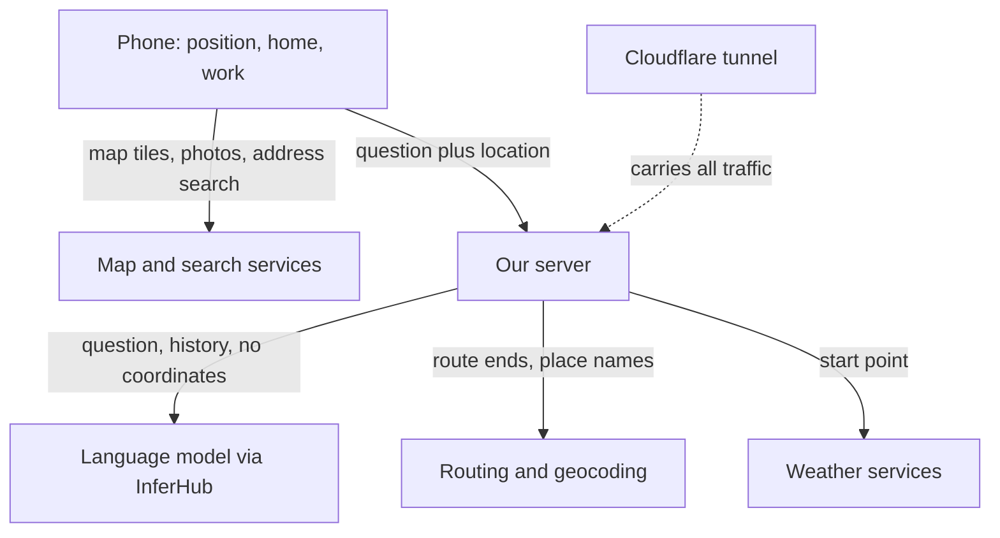
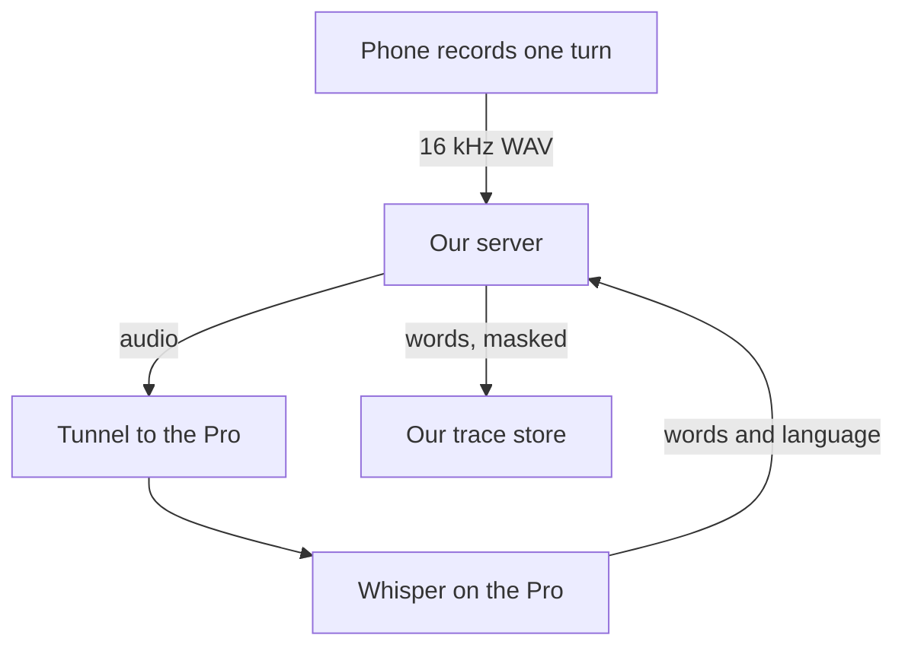

# Location data policy

> Approved by the owner on 2026-10-25 (issue #374, part of #361). It describes what the code does on main; the gaps below are what is still to do.

## The rule in one paragraph

Your exact position stays on your phone unless you tap **Use my location** or ask the assistant a question that needs it. When it leaves the phone, it goes to our server for that one answer and is not written down there. If you use the microphone, the recording goes to our server and then to a speech server on the owner's own machine, and neither of them keeps it. Our server passes only what each outside service needs to answer: a routing service gets the two ends of the route, a weather service gets a rough area, and the language model gets words like "here" and "home" rather than numbers. Saved home and work stay on your phone until you clear them.

## How location moves through the app

The same flow as a list, in case the diagram does not render:

1. The phone keeps your shared position in memory. Home, work, usual rides, recent chats and recent trips are kept in the browser's storage, each behind its own switch in "What we remember".
2. The phone talks directly to map tile, street photo, address search and walking route services.
3. When you ask the assistant, the phone sends the question, the conversation so far, your shared position (if sharing is on) and, in the home screen's assistant, one line built from what the phone remembers, such as "Home is Jackson Heights" (names and a clock only, never coordinates) to our server.
4. Our server sends the question and the conversation to the language model through InferHub, a paid marketplace that forwards requests to model providers. Your position is not sent: the model says "here", and our server puts the exact point into the route or search itself.
5. Our server looks up routes, addresses and weather with outside services, sending them coordinates.
6. All traffic between the phone and our server passes through Cloudflare, which runs the tunnel to our machine.

## What stays on your phone

| Data | Where it is kept | How long | How to clear it |
|---|---|---|---|
| Your live position after **Use my location** | Page memory only, never browser storage, cookies or the web address (`src/lib/geo/sharedLocation.ts:3-9`) | Until you tap **Stop sharing location** or close the tab | **Stop sharing location** (`src/lib/geo/sharedLocation.ts:59-63`) |
| Your position during 2D turn-by-turn navigation | Page memory only (`src/features/liveview/RouteGuide.tsx:113-141`) | Until navigation stops or the route is cleared | Stop navigation |
| Route start and end you picked on the map | Page memory only (`src/lib/store/DataViewContext.tsx:161`) | Until you clear the route or close the tab | Clear the route |
| Assistant conversation | Page memory, plus recent chats in browser storage under `nma.chats` while the Chats switch is on (`src/lib/memory/memory.ts`) | Kept chats drop after 30 days, at most 30 | The Chats switch, or **Delete everything** |
| Saved home and work | Browser storage under `nma.homeWork`, as a label and a point (`src/lib/memory/memory.ts`, `saveHomeWork`) | Until cleared | The Home & Work switch, or **Delete everything** in the menu (`src/components/MenuRow.tsx`, `forgetEverything`) |
| Usual rides and recent trips | Browser storage under `nma.commute` and `nma.lookedUp`; trip ends keep exact points only while Exact location is on (off by default) | The last 5 trips | Their switches, or **Delete everything** |
| Starred stations, map settings, theme | Browser storage (`src/features/transit/hooks.ts:219-239`, `src/lib/map/mapOptions.ts:49`) | Until cleared | Browser settings. These are not positions. |

The web address never carries your position. The `at=` parameter is read when someone opens a shared street link (`src/components/MapView.tsx:308`), but the app never writes your position into it. Filters and transit choices in the address are not locations.

## What reaches our server

| Request | What it carries | Kept? |
|---|---|---|
| Ask the assistant (`POST /api/agent`) | The conversation (up to 30 messages), your exact shared position if sharing is on (`src/features/agent/schema.ts:154`, sent at `src/features/agent/AgentOverlay.tsx:112-128`), your street view spot and heading if you asked from street view, and from the home screen one remembered line of names (`src/features/agent/memorySummary.ts`) | The question, answer and location are not stored. Two things are kept. To share the free allowance fairly, your internet address is held in server memory with the times of your recent questions, for at most 3 hours and never written to disk (`server/features/agent/fair-use.ts`, keyed at `server/features/agent/routes.ts:48`). A timing row (model, how long each step took, how it ended) goes to `core.agent_runs` for 30 days, with no question, answer, location or address (`server/features/agent/runLog.ts`). |
| Voice question (`POST /api/stt`) | One recording of your voice, at most about a minute, turned into a 16 kHz WAV on the phone first (`src/lib/voice/serverStt.ts:122-154`), plus the language you picked or "auto" | The recording is not stored: our server hands it to the speech server and keeps no copy (`server/features/agent/stt.ts:63-98`). As with a typed question, your internet address is held in server memory with the times of your recent recordings, for at most 3 hours and never written to disk (`server/features/agent/stt.ts:28`). The words the speech server heard are sent to our trace store (see below), with email addresses, birth dates and social security numbers masked (`server/features/agent/stt.ts:81`, `server/lib/tracing.ts:20-22`). |
| Weather for the map (`GET /api/weather`) | The map centre rounded to about 100 metres (`src/features/weather/weatherLayers.ts:37`) | Held in a memory cache for about 10 minutes, keyed by an area about 5 kilometres wide (`server/features/weather/routes.ts:66-70`) |
| Parking rules near a place (`GET /api/parking/rules`) | The picked place to about 1 metre (`src/features/parking/StreetRules.tsx:12`) | Held in a memory cache for an hour, keyed by an area about 100 metres wide (`server/features/parking/routes.ts:166-167`) |

**Server logs.** Neither our server nor Caddy (the web server in front of it) writes a line per request:

- The app adds no request logger (`server/app.ts`, `server/node.ts`).
- The Caddy configuration has no `log` directive, and Caddy writes no access log without one (`deploy/Caddyfile`).
- The server prints only its start-up line, model failures (status and up to 160 characters of the provider's error text, `server/features/agent/routes.ts:81-86`, `server/features/agent/model-fallback.ts:67`, `:76`) and transit feed errors (`server/features/transit/routes.ts:285`).
- Container logs are capped at three 10 megabyte files (`deploy/docker-compose.yml:34-36`).

Not checked: whether Cloudflare keeps request logs for our account, and whether our own trip planner container logs trip searches (see gaps).

**Our trace store.** Every finished assistant turn and every speech-to-text call becomes one trace in a Phoenix project we run through Octo, our own database service (`server/lib/tracing.ts`, written from `server/features/agent/runLog.ts:111-123` and `server/features/agent/stt.ts:81`). A trace carries words, not just timings: the question, the answer, the steps each tool took and how long each took. Before a trace leaves our server, email addresses, birth dates and social security numbers are replaced with `[email]`, `[dob]` and `[ssn]` (`server/lib/tracing.ts:20-22`). The browser sends a session id (`x-session-id`) that groups one visit's traces together; it carries no position. Tracing is on in production today.

## What happens to your voice

Speaking a question takes the same road as typing one, plus one stop at the end. The recording never goes to a company: it goes to a speech server on the owner's own MacBook Pro, which runs Whisper, an open speech model, on its own graphics chip.

The same flow as a list, in case the diagram does not render:

1. The phone records one turn and stops by itself after a short silence (`src/lib/voice/serverStt.ts:37-41`). It decodes the clip and resamples it to a 16 kHz mono WAV, because the speech server reads WAV and not the format a browser records (`src/lib/voice/serverStt.ts:122-136`).
2. The phone posts that one file to `/api/stt` on our server, with the language you picked or `auto` (`src/lib/voice/serverStt.ts:141-154`). The recording is capped at 2 megabytes, about a minute of speech (`server/features/agent/stt.ts:27`).
3. Our server passes the file to the speech server named by `STT_BASE_URL` and keeps no copy (`server/features/agent/stt.ts:63-98`). On the live site that address is a tunnel the Pro opens to our server, so the audio goes from one of the owner's machines to another.
4. Whisper large-v3-turbo, running on the Pro, returns the words and the language it heard. Our server sends them back to the phone, where they become the question you would otherwise have typed.
5. The words are also written to our trace store, the same place a typed question's words go (`server/features/agent/stt.ts:81`). Email addresses, birth dates and social security numbers are replaced with `[email]`, `[dob]` and `[ssn]` before anything leaves the server (`server/lib/tracing.ts:20-22`).

Two consequences worth knowing. The speech server holds one voice model at a time, so the first voice question after the owner used it for something else waits about half a minute while the model loads. And if the Pro is asleep or its tunnel is down, the microphone says voice is unavailable while typing keeps working.

## What reaches the language model

The model runs outside our machine. Our server calls InferHub with the `@ai-sdk/openai-compatible` library (`server/features/agent/routes.ts:52-57`). InferHub forwards each request to one of several model providers. Every question sends:

- **The whole conversation so far**, including any addresses you typed (`server/features/agent/routes.ts`).
- **Whether you shared a location or are in street view**, as words only. The instructions say "The user shared their location" and never its numbers (`server/features/agent/prompt.ts`).
- **Tool results with your point taken out.** Before a tool's result goes back to the model, any point within about 150 metres of you is replaced with "here" (`hideHere` in `server/features/agent/tools.ts`). Other places, such as a restroom or a station exit, keep their real positions. Home and work reach the model only as names in the remembered line.

The map on your phone still gets exact points, because our server sends map commands straight to the phone, not through the model.

How long InferHub or the provider behind it keeps a request is not known; we have not read their terms.

## What reaches each outside service

| Service | Who runs it | What it receives | Sent from |
|---|---|---|---|
| Map tiles (OpenFreeMap, OpenStreetMap tiles) | OpenFreeMap; OpenStreetMap Foundation | Which tiles you view, which shows the area you are looking at, plus your internet address | Phone (`src/lib/map/basemap.ts:13`, `src/lib/map/style.ts:22`) |
| Address search (GeoSearch) | NYC Department of City Planning | Text you type into search; your internet address | Phone (`src/lib/api/geosearch.ts:23`) |
| Address search for the assistant | Same | Place names the assistant looks up, and exact points to name a street (`server/features/agent/services.ts:29`, `:49`, used at `server/features/agent/trip.ts:36`) | Our server |
| Walking routes (OSRM, the Open Source Routing Machine) | FOSSGIS, a German volunteer association | Both route ends to about 10 centimetres; from the phone, also your internet address | Phone (`src/lib/api/routing.ts:46-56`) and our server (`server/features/agent/services.ts:73-74`) |
| Driving routes (OSRM car) | FOSSGIS | Both route ends | Our server (`server/features/agent/drive/router.ts:51`) |
| Transit trip search (MOTIS, or OpenTripPlanner if the owner switches) | Us, in our own container | Both trip ends | Our server (`server/features/agent/plan.ts:16`). Stays on our machine. |
| Weather forecast (Open-Meteo) | Open-Meteo | The assistant's trip start exactly (`server/features/agent/services.ts:89`, called from `server/features/agent/plan.ts:19`); the map's weather an area about 5 kilometres wide (`server/features/weather/routes.ts:44`) | Our server |
| Weather alerts (NWS, the National Weather Service) | United States government | The trip start to about 10 metres (`server/features/agent/services.ts:99`) | Our server |
| NYC Open Data | City of New York | A box around a driving route (`server/features/agent/drive/context.ts:59`); a circle around a picked parking place (`server/features/parking/routes.ts:183`) | Our server |
| Street photos (Mapillary) | Meta | A box around the block you opened, plus your internet address (`src/lib/api/mapillary.ts:98-115`, `src/components/StreetViewSheet.tsx:101-103`) | Phone. Uses the picked block, not your position. |
| MTA (the Metropolitan Transportation Authority) feeds | MTA | No location. We download whole feeds. (`server/features/agent/services.ts:109`, `:130`) | Our server |
| Speech recognition for "Hey map" | Your browser's maker | Your voice, if you turn it on (`src/features/agent/useWakePhrase.ts:26-27`) | Phone |
| Cloudflare tunnel | Cloudflare | Every request to our server, including the assistant questions and coordinates above | In transit |

Calls our server makes do not reveal your internet address to the outside service. Calls the phone makes do.

## Gaps found, with recommended fixes

1. **Exact coordinates went to the model.** Fixed: the instructions say only that you shared a location, and tool results replace your point with "here". Tests check that neither the prompt nor a `geocode` of "here" carries the numbers.
2. **The on-screen promise was wrong.** Fixed with this update: the assistant now says your location goes with each question until you tap Stop sharing location, which is what the code does.
3. **Saved places go with every home-screen question** as names, even when the question is not about them. *Fix:* send the remembered line only when the question names home, work or a usual ride.
4. **One-step clear.** Done: **Delete everything** in the menu clears every kind the phone remembers (`forgetEverything`).
5. **Model provider retention is unknown.** *Fix:* read InferHub's terms, record how long it and its providers keep requests, and pick a no-retention option if one exists.
6. **Cloudflare and trip planner logging not checked.** *Fix:* check the Cloudflare account's log settings and the trip planner container's log level, then record the answer here.
7. **More precision than needed.** Weather alerts and forecasts for a trip get the exact start; the phone sends parking lookups to about 1 metre. *Fix:* round to about 1 kilometre for weather and alerts, about 10 metres for parking.
8. **The policy in the app.** Done: **Your data → Data policy** in the menu states the rule in each app language. A link to this full page is still to do.
9. **Voice and traces were not described.** Fixed with this update: the page now has a voice section and says what our trace store keeps. The voice recording itself still goes nowhere but our own two machines.
10. **Trace retention is unknown.** *Fix:* read what Octo and Phoenix keep by default, record how long a trace lives, and pick a shorter period if the answer is longer than the 30 days we keep timing rows.

## Caveat

This page was written by reading the code; nobody watched network traffic to confirm it. Line numbers drift as the code changes, so file names are the safer pointer.
