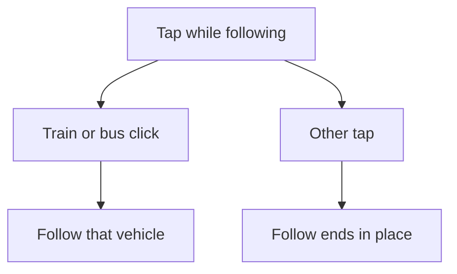

# PR #337: fix(transit): end Follow on Show on map, Show map, and map clicks

- State: closed (2026-10-25)
- Opened by Pukujan on 2026-10-23
- Original: https://github.com/Pukujan-lab/nyc-map-agent/pull/337
- Branch `fix/follow-clear-on-map` into `main`, +57 −10 in 7 files

Following a train or a bus kept the camera glued to that vehicle after "Show on map", "Show map", or a click on the map. The alert, the layers drawer, and the corner map could not keep the view.

## What changes
- "Show on map" on an alert drops Follow in place, then the map flies to that alert. This is not Stop following, which eases the camera back to the view from before Follow.
- "Show map" in Layers drops Follow, then closes the drawer.
- "Show map" on the street-level corner map drops Follow, then brings that small map back.
- A map click that is not a train or a bus drops Follow. A click on a train or a bus still starts Follow on that vehicle.

1. A train or bus click starts Follow on that vehicle.
2. Show on map, Show map, or any other map click ends Follow where the camera already is.

## How to verify
- Follow a train, tap "Show on map" on an alert, and the follow card is gone while the map stays on that alert.
- Follow a train, tap "Show map" in Layers, and Follow ends.
- Hide the street-level corner map, tap "Show map", and Follow ends.
- Click empty map, a station, or anything that is not a train or a bus, and Follow ends.
- Click a train or a bus, and Follow starts on that vehicle.
- Drag the map, and Follow still ends.

The follow-click decision tests passed (2 tests). The existing follow-camera tests still passed (8 tests).

## Unchanged
- Dragging the map still ends Follow. Stop following still eases the camera back.
- An empty map tap still leaves the layers drawer open, as in the closed log #280. A train or bus tap still closes that drawer.
- Underground dash widths stay as filed in #331. Copying filter layers onto the corner map stays out, as filed in #334. Only the corner map's Show map button changed.
- The all-JavaScript size cap stays 945 kB. The shared 3D layer was not edited.

Next: follow one train and tap Show on map, then an empty part of the map.

Closes #333

---

**Pukujan commented, 2026-10-25**

Closing as covered by main: the work in this pull request is already on main, mostly brought in by #395 (the agent-first home) and the fixes after it; a line-by-line check found most of what this adds already present. Triage recorded in #376. The branch stays on GitHub if anything here turns out to be missing.
