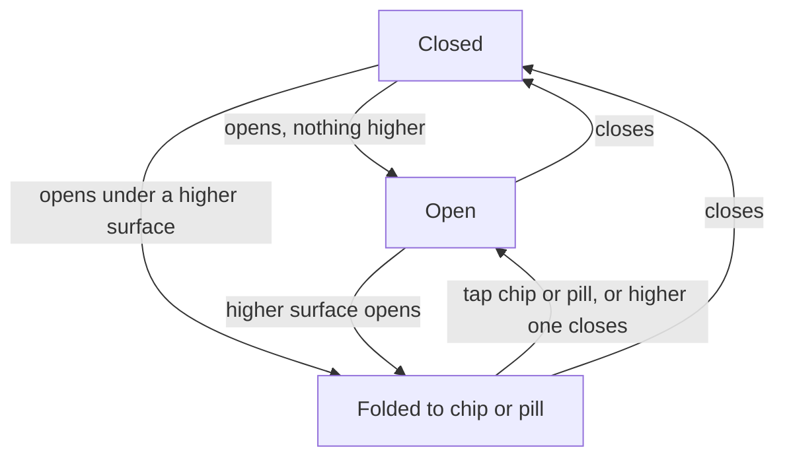

# PR #412: feat: one screen-space arbiter; answer and line panel make room, checked at six sizes

- State: merged (2026-10-25)
- Opened by Pukujan on 2026-10-25
- Original: https://github.com/Pukujan-lab/nyc-map-agent/pull/412
- Branch `feat/screen-space` into `main`, +442 −25 in 10 files, merge commit ea8eb217c77a71d87a58b366d0b80b98130ac9a0

**Problem.** The answer card, the voice orb, a running task, the menus and the line panel all want the same small screen. On a phone they covered the person's dot or the followed train. The PDD (the product design doc) ranks who wins, but the code only followed it by convention: each panel kept its own state, and nothing tested how they combine.

**What changes**
- **One arbiter** decides who gets the screen: `src/lib/screen/screenSpace.ts`, an [XState](https://stately.ai/docs/xstate) state machine.
  - Each surface reports only whether it is open. The machine decides what shows, what folds to its chip or pill, and which menu closes.
  - It replaces three separate pieces of state from the first commit (the answer's fold, an "answer shown" signal, and the line panel's own fold).
- **The rules it enforces** (from `docs/PDD.md`, "Screen space"):
  - A running task or an open menu folds the answer to its question chip. Tapping the chip brings the answer back.
  - Sending a question closes any open menu.
  - A task, the voice orb or a newly picked line closes an open menu.
  - On a phone (under 640 px), the line panel folds to its pill while the answer or the orb is open. Tapping the pill opens the panel again.
  - On a small phone, only one can be open: opening the line panel folds the answer.
  - From 640 px wide, the line panel docks to the side and both stay open.
- **Tests**
  - A unit test opens every pair of the five surfaces, in both orders, at small-phone, phone and wide sizes. Its expected results are written out by hand, not computed from the machine. A second test fails if any pair is missing from the table.
  - A Playwright check at six sizes (320×568 up to 1440×900) checks that:
    - the map keeps at least 160 px clear;
    - a menu folds the answer;
    - Escape steps back exactly one level;
    - sending a question closes the menu.

| Opened together | Small phone | Phone (375–639 px) | 640 px and up |
|---|---|---|---|
| Answer + menu | answer folds to its chip | answer folds to its chip | answer folds to its chip |
| Answer + task | answer folds to its chip | answer folds to its chip | answer folds to its chip |
| Answer or orb + line panel | line folds to its pill; tapping the pill folds the answer | line folds to its pill; tapping the pill shows both | both stay, docked to opposite sides |
| Menu, then task, orb or line | menu closes | menu closes | menu closes |

How a surface's state moves (diagram)

**Cost.** xstate adds 13 kB (brotli) in its own lazily loaded chunk; the main bundle doesn't change. Budgets changed:
- total JavaScript: from 1000 kB to 1015 kB;
- the agent overlay chunk: from 21 kB to 21.2 kB;
- a new budget line for the xstate chunk: 13.5 kB.

**How to verify.**
- `npm test`: all 1079 unit tests pass, 70 of them new for the screen-space rules.
- `npx playwright test`: all 28 browser tests pass.
- Lint, feature-boundary and size checks pass locally.

**What stays unchanged.**
- The map's cover padding (PR #410).
- The menu store and its order.
- Escape and Back handling.
- Hands-free still ends when a task starts; the agent overlay does that, as before.

Refs #370

🤖 Generated with [Claude Code](https://claude.com/claude-code)

