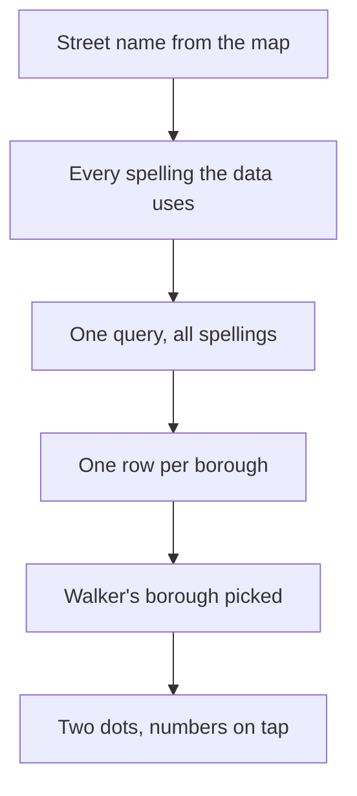

# PR #450: feat(walk): noise and crash dots for the street underfoot

- State: merged (2026-10-25)
- Opened by Pukujan on 2026-10-25
- Original: https://github.com/Pukujan-lab/nyc-map-agent/pull/450
- Branch `feat/walk-street-levels` into `main`, +380 −9 in 8 files, merge commit 0580efac977c0675d9010a72bf065831f3cecd19

While you walk at street level, the app now shows how loud and how crash-prone the street underfoot is, green to red against every other street in the city. Until now it couldn't: the street data keeps each street under its source's spelling ("WEST 44 STREET" for noise complaints, "W 44 ST" for police crash reports) and the map calls it "West 44th Street", so no lookup ever matched.

Closes #7

## What changes

- **`/api/street` matches any spelling.** `api/_lib/streetNames.ts` expands a name into the spellings the data might use (44th → 44, Street ↔ St, Avenue ↔ Ave/Av, West ↔ W, Eighth ↔ 8, and similar), queries them all at once, and folds the rows into one per borough. Counts add up; each colour comes from the spelling that holds most of that metric, because a spelling with no noise reports still gets a noise colour and must not decide it. Rows with no borough are dropped.
- **Two dots on the walk card.** "● Noise ● Crashes" sit under the street name. Tapping them adds one line: "Past year: 209 noise complaints · 26 crashes, 10 with injuries". Screen readers hear "Noise very high". Streets with no records show nothing.
- **Borough.** The card picks the walker's borough from the neighbourhood outlines when they are loaded, otherwise from the nearest guide landmark, otherwise the busiest borough for that street.
- **Phone layout.** The taller card now stops short of the compass and locate buttons, and the walk pad moves from the right, where it covered "Leave street view" and the mini-map, to the empty left side.

1. The map gives the street name. 2. The server expands it into spellings. 3. One query reads them all. 4. Rows fold into one per borough. 5. The card picks the walker's borough. 6. It shows two dots, with numbers on tap.

## How it was checked

- The spelling expansion and merge give one row with both noise and crash numbers for West 44th Street, 8th Avenue, East 14th Street, Queens Boulevard and Atlantic Avenue, run against production's street data.
- In a dev build fed by that same merge, walking on West 45th Street shows red noise and crash dots, and the tap shows 209 complaints and 26 crashes. At 390 px wide nothing overlaps.
- Typecheck, lint and every unit test pass (1232 tests, 8 new). All size limits pass.

## What stays the same

The response still has `name` and `rows`; rows now carry numbers instead of numeric strings and no longer carry `street`. Nothing else in the app calls this endpoint.

🤖 Generated with [Claude Code](https://claude.com/claude-code)

