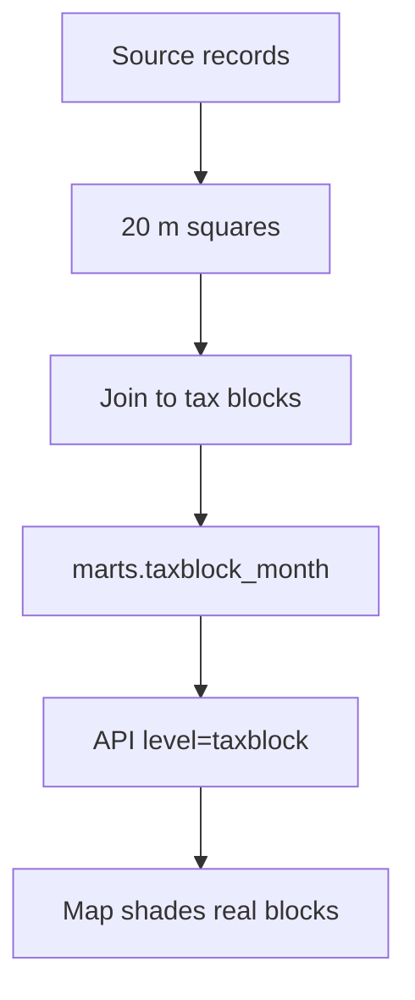

# PR #461: feat(blocks): registry sources counted per real tax block

- State: merged (2026-10-25)
- Opened by Pukujan on 2026-10-25
- Original: https://github.com/Pukujan-lab/nyc-map-agent/pull/461
- Branch `feat/taxblock-counts` into `main`, +329 −47 in 12 files, merge commit f713c58beaa75516639ce462e7b9d2ed189af3d2

**Problem.** When you zoom into a neighbourhood, sources like trees, 311 complaints or permits shade the map in 300 m squares, not in the city blocks people actually walk past. Only noise and crashes were counted per real block (a "tax block", the city's own lot-block outline). Issue #120 asked for every source to land on real blocks.

**What changes**
- The ingest also keeps each registry source on a fine grid of about 20 m squares (`raw.source_fine_cells`). If that step fails it only warns, so the 300 m grid keeps working.
- The aggregate build joins those small squares to tax blocks with the same rule noise and crashes already use: a point inside a block counts there, and a point in the street is split between the blocks facing it. The results go to a new `marts.taxblock_month` table, per month and category.
- `GET /api/v1/blocks?level=taxblock` serves those counts, keyed by block id, with the borough, neighbourhood and category filters.
- The app asks for tax blocks first and falls back to the 300 m grid when there are no rows yet, so nothing goes blank before the first ingest.

1. Source records → 20 m squares → join to tax blocks → `marts.taxblock_month` → API `level=taxblock` → the map shades real blocks.

**How to verify**
- The unit tests cover the new query, plus the client's two paths: tax-block rows are keyed by block id, and empty rows fall back to the grid. The full unit suite passes (1242 tests), along with typecheck, lint and the dependency-boundary check.
- A local DuckDB check on synthetic blocks confirmed the counts: weighted totals, the street split between facing blocks, and inventories with no month. The existing noise join is unchanged.

**Caveats**
- This has not run against the live warehouse. The migration is exercised only in CI, because Docker isn't running locally. Real counts appear after the next ingest and aggregate run.
- The injury-severity filter only applies to crashes, so asking for it at tax-block level returns no rows.

**What stays the same**
- Noise and crash blocks, the 300 m grid, and every existing API level.
- `openapi.json` only gains the `taxblock` value for `level`, which is a non-breaking addition.

Closes #120

🤖 Generated with [Claude Code](https://claude.com/claude-code)

