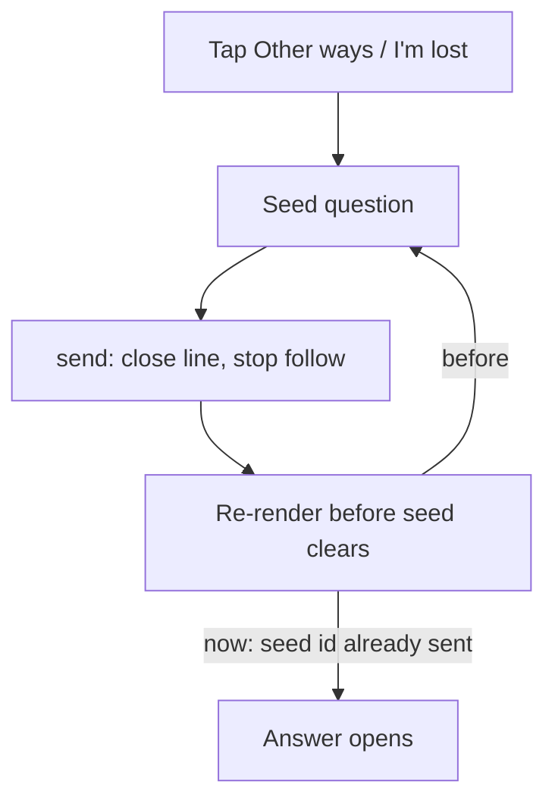

# PR #462: fix(agent): Other ways and I'm lost no longer freeze; suspended stretches draw broken under the shuttle

- State: merged (2026-10-25)
- Opened by Pukujan on 2026-10-25
- Original: https://github.com/Pukujan-lab/nyc-map-agent/pull/462
- Branch `fix/ask-buttons-stuck` into `main`, +106 −19 in 8 files, merge commit 5b20476b709e11e233b3bc8f7b390e8252a52cc7

Tapping **Other ways** on a line, or **I'm lost** on a walk, froze the whole app: the page stopped responding and nothing could be tapped. The owner hit it twice on 2026-10-25.

## What changes

1. **No more freeze.** Both buttons hand a question to the assistant (a "seed"). Sending it closes the line panel and the followed train. Those updates re-rendered the assistant before the seed was cleared, so the same question was sent again, endlessly. Each seed now sends exactly once (`src/features/agent/AgentOverlay.tsx`).
2. **The answer shows during a task.** When the first answer arrived, the screen manager (`src/lib/screen/screenSpace.ts`) forgot that the person had just asked. During a walk or a follow, it folded the answer to its chip at once. A sent question now opens its answer. Opening a menu still folds it.
3. **A suspended stretch reads as broken.** For an alert like "No [M] between Myrtle Av (Broadway) and Delancey St-Essex St":
   - the map cuts the line under the replacement shuttle and draws thin dashes on top, so both the broken train link and the blue T432 bus are visible;
   - only the stations inside the stretch are marked Skipped (Marcy Av, Hewes St, Lorimer St, Flushing Av). The two ends, where trains still turn, are not;
   - both ends are labelled "Take the T432 bus here".
4. **Trains sit on their track.** In the flat view, a train stopped at a station used to float 52 px above the line, so it looked off the track. It now stays on the line. The 3D view keeps its lift.

The diagram's flow, as text: the tap seeds a question → `send()` closes the line and stops the follow → that re-renders before the seed clears → before this change, the seed effect sent again (the loop); now the seed's id is already marked as sent, so the answer opens.

## How to verify

- `pnpm test` passes (1,252 tests). New tests cover:
  - a question sent during a task opening its answer;
  - the real M suspension text cutting exactly Myrtle Av to Delancey St-Essex St;
  - flat-view trains staying on the track.
- Reproduced in a headless browser against a local build:
  - before this change, the click on Other ways never returned (the main thread hung, and paused stacks showed the seed effect re-sending);
  - after it, the page answers in under 100 ms and the reply appears.
- Screenshot check of the M notice: the dashed stretch, the shuttle drawn on top, the four skipped stations, and both "Take the T432 bus here" labels.

## What stays the same

- Trains and buses always draw. A live M train inside the gap still shows.
- Alerts that are not "No [X] between A and B" keep the bright highlight.
- The 3D view's bullet lift is unchanged.

🤖 Generated with [Claude Code](https://claude.com/claude-code)

