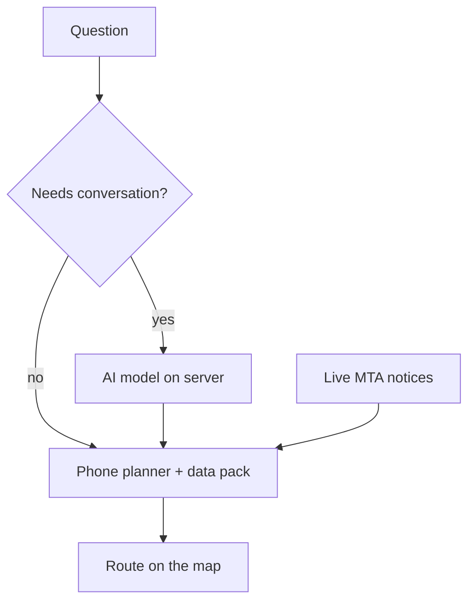

# Issue #509: Directions need a connection: on-device trip planning for a later release (owner raises it, not agents)

- State: open
- Opened by Pukujan on 2026-10-27
- Original: https://github.com/Pukujan-lab/nyc-map-agent/issues/509

> **Owner's standing rule for this log:** don't work on this, and don't suggest it, unless the owner brings it up first. It's written down for a possible full app release later, not as a plan.

## What was observed

Trip planning needs our server today. The phone sends the question to our server. The server asks the AI model, and the model calls our hosted trip planner, OpenTripPlanner (the free, open-source planner that searches MTA timetables plus the street map). Without a connection there are no directions at all, even though the timetables only change about weekly.

## Idea, as discussed (proposal)

*(proposal; none of this exists yet)*

1. **Plan trips on the phone.** A lighter timetable-only planner, for example a RAPTOR-style search (it scans trips round by round, one more transfer each round), could run on the phone. Walking would be simple "footpaths between nearby stops" instead of full street routing.
2. **Ship a compact data pack.** New York's subway and bus timetables, plus station entrances and exits, compressed to roughly 20–40 MB. That's an estimate, not measured. Compression is how it fits on a phone, and the app updates the pack about weekly.
3. **Keep the network only for live data.** MTA notices, delays and elevator outages are small downloads.
4. **Keep the AI only for conversation.** Turning words into a request and explaining the result needs the model; the route search itself doesn't.

Same flow in words: a plain trip request goes straight to the planner on the phone. A conversational question goes to the AI model, which then calls the same phone planner. Live MTA notices feed into the planner, and the result draws on the map.

## Tradeoffs

- A large first download, and a weekly timetable refresh.
- Walking directions are less exact than today's full street routing.
- Two planners to keep consistent, or a full move off the server one.
- Sizable engineering effort.

## Caveat

The size and speed figures are estimates from general experience with timetable planners, not measured on this app's data.

## Record

- **Kind:** observational (a capability gap, nothing broken)
- **Lifecycle status:** open
- **Impact if unresolved:** low. Directions need a connection; newcomers without data or with a weak signal underground get none.
- **Likelihood:** observed (it's how the app works today)
- **Evidence confidence:** supported (architecture: `server/features/agent/otp.ts`, `server/features/agent/plan.ts`)
- **Release relevance:** unrelated to the hackathon submission. It might matter for a later full app release.
- **Risk of the proposed change:** high effort; possible drift between planners.
- **Priority path:** unresolved (this project's priority paths still carry the generic meanings)
- **Ontology:** OIO 0.2.0, issue-log ontology 1.1.0, project extension 1.0.0
- **Filer origin:** human-via-agent. The owner directed the filing in a Claude Code session on 2026-10-26 ("write it down in issue log"). The GitHub actor is the owner's account; the content author is Claude, an AI agent.
- **Destination:** Pukujan/nyc-map-agent

related: #418

