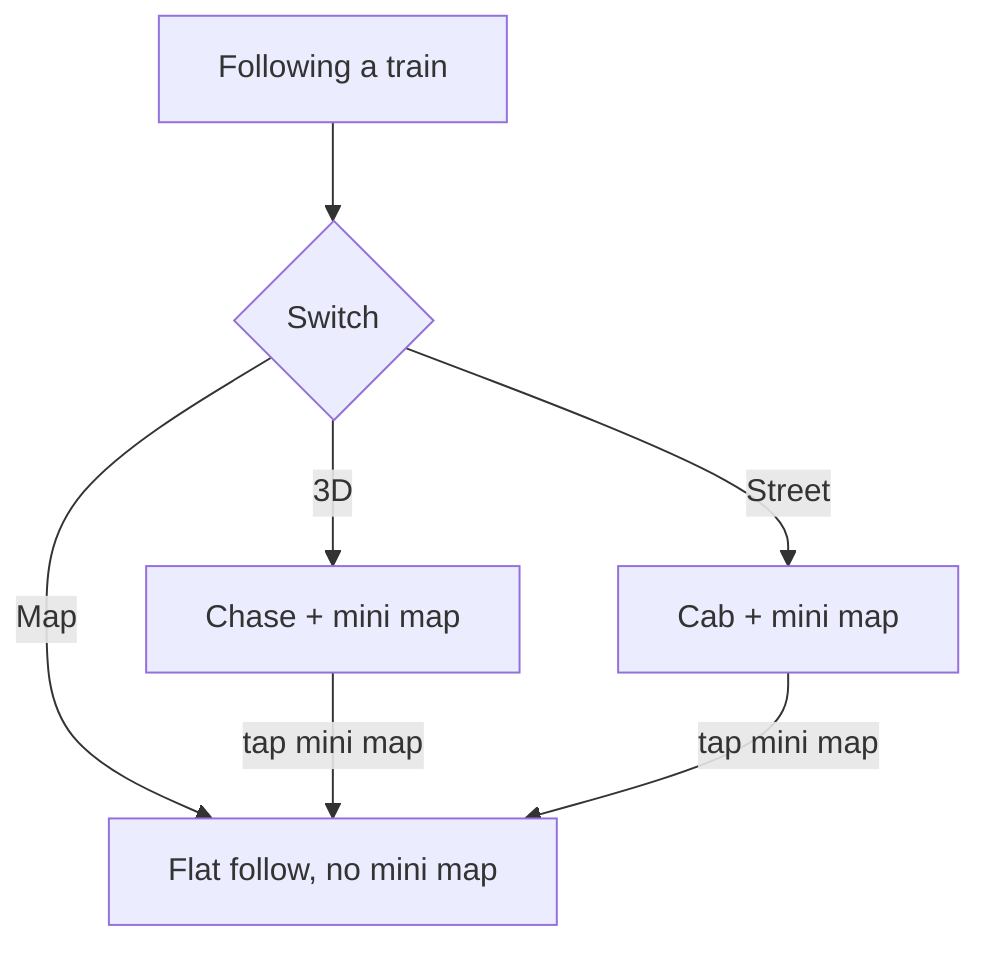

# PR #520: feat(follow): pull the camera back, add a follow mini map, switch views while following

- State: merged (2026-10-27)
- Opened by Pukujan on 2026-10-27
- Original: https://github.com/Pukujan-lab/nyc-map-agent/pull/520
- Branch `feat/follow-minimap-main` into `main`, +140 −13 in 6 files, merge commit 9b5f272d5e7bd7479d15cf67cbd5c7511bdcabb7

## Problem

When you follow a train, the Side and Chase cameras stand so close that you can't see where the train is or what's around it. Nothing on screen shows where it is on its line, either. The owner asked for "side view a bit further … minimap too", and a mini map for the chase camera and for street view while chasing.

## What changes

- **The follow camera stands further back.**
  - Desktop: Side is about 170 m out and 75 m up, looking a little ahead; Chase is about 140 m back and 70 m up.
  - Phones: both are higher and more top-down, so the train stays clear of the follow card and the right-hand buttons.
- **A follow mini map.** While any follow camera is on (Chase, Side, Overhead, Street/cab), a small north-up map in the bottom-right corner, above Locate, shows:
  - the train's own line in the line's colour;
  - the train, with an arrow for its heading;
  - "Next: \<station\>".

  Tapping it goes to the flat Map follow. It's hidden in Map mode.
- **The Map · 3D · Street switch works while following.** Map is the flat follow, 3D is Chase, and Street is the cab view. Phones keep using the cube menu, which already lists the follow cameras.
- **Underground stretches.** The existing x-ray already switches on by itself while a followed train runs underground (`xrayForFollow`), so Street (cab) and Chase show the tunnel through the street. The mini map keeps your place either way. No new behaviour was added for this.

In words: Map is the flat follow with no mini map. 3D and Street both show the mini map, and tapping it returns to Map.

## How to verify

1. Open the 2 line and tap **Follow a train**.
2. Pick **3D**, then **Street**, using the top switch (desktop) or the cube (phone).
3. Check that the train sits clear of the bottom card and the right-hand buttons.
4. Check that the mini map shows the red 2 line and "Next: 50 St".
5. Tap the mini map: the camera goes flat and the mini map goes away.

What I checked:
- Headless at 1280×800 and 375×667, using the e2e live fixture:
  - Desktop: the train is around the middle of the screen, with the mini map at x 1084–1264, y 456–636, clear of the card (y 614+, x ≤ 392) and Locate (y 648+).
  - Phone: the train is at about x 186, y 260–410, clear of the card (y 499+) and the mini map (x 239+).
- Type check, lint and unit tests pass (1,340 tests).
- Size budgets are within limits; nothing was raised.
- End-to-end tests run in CI only, because this Mac is short on memory.

## What stays the same

- The Overhead and flat Map follow cameras.
- The street-view mini map.
- The follow card.
- Phones still change follow cameras from the cube menu.

Stacked on #517 (notice tap frames it on Map). Refs #418

🤖 Generated with [Claude Code](https://claude.com/claude-code)

Re-opened against main: #519 merged into the #517 branch after #517 had already landed, so this change never reached main.

