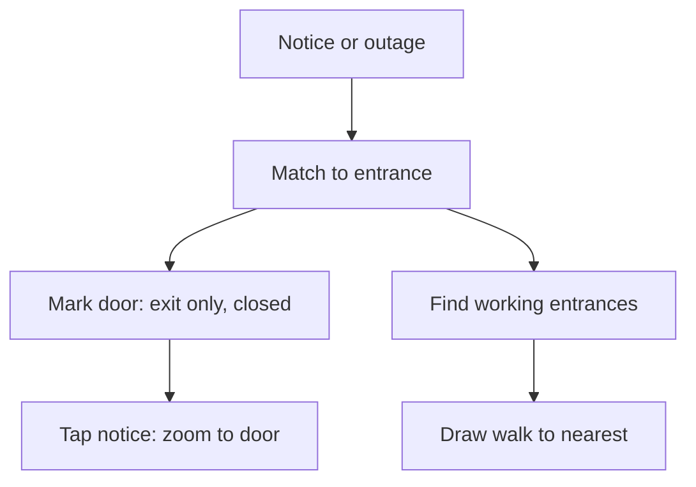

# Issue #532: Accessibility first: show the working entrance and the way to it on the map, not just the outage

- State: open
- Opened by Pukujan on 2026-10-27
- Original: https://github.com/Pukujan-lab/nyc-map-agent/issues/532
- Labels: account:unrecognized, authorization:claimed, exposure:active-production, filer:human-via-agent, evidence:supported, likelihood:observed, needs-human-verification, impact:moderate, needs-priority-definition, observational-issue, ontology:oio-1.1.0, ontology:project-1.0.0, proposal, queue:class-3, queue:class-3:account-99, recoverability:documented-recovery, relation:related, release:affects, review:product-outcome-review, status:open, type:observational

### Summary

> **Owner's direction:** make accessibility a first-class problem, not a footnote on a notice. Logged for now; not yet planned or built.

Elevator, escalator and entrance notices say what broke, but the map doesn't show which entrance still works or the way to it.

People who can't use stairs, people with strollers or luggage, and newcomers who don't know the station rely on knowing **which door works**. MTA puts this in notification text. The owner's idea is to **show it on the map as something you can follow**: the door that works, and the walk to it.

### Identity and Lineage

- Leaf issue: this one
- Parent: none
- Task/branch: none yet
- Filed 2026-10-27 as prose; rewritten in the intake form's shape on 2026-10-29 so OIO's triage can read it (#591). The original wording is kept in the fields below.

### Acceptance Criteria

- [ ] H1 and H2 are tested against one day of the live feed, with counts of unique, ambiguous and unmatched matches
- [ ] An outage or entrance notice marks the exact entrance with its state (Exit only, Closed, No escalator)
- [ ] A working entrance and the walk to it are drawn on the map
- [ ] Tapping an entrance notice or an entrance row flies to that entrance
- [ ] An ambiguous match is shown as unsure, never as certain

### Boundaries and Next Action

Logged for now; not yet planned or built.

Next action: run the H1 matcher experiment over one day of the live feed.

### Symptoms

1. **Outages say what broke, not what to do.** A station card lists "4 escalators out at Lexington Av/63 St" with each escalator's route through the station, then stops. The rider still has to work out how to get in or out.
2. **Notices name the station, not the door.** "Enter 5 Av/53 St E/F Station at 5 Av only. Madison Av entrance will be exit only" puts one "Affected" marker on the station. The map doesn't say which entrance is exit-only or which one still lets you in.
3. **Entrances are tiny and look alike when zoomed in.** At block level an entrance is a small dot. Nothing on it says which corner it is, whether it's stairs, an escalator or an elevator, or that it's closed or exit-only.
4. **Tapping a notice doesn't zoom to the entrance.** The rider has to zoom in by hand to find the affected door.
5. **The station card's entrance list is plain text.** Rows like "5 Av/53 St · Stair" are not buttons. They can't be tapped to show that entrance, and three rows that read the same can't be told apart.

### Hypotheses (unverified)

- **H1: the corner can be matched from text.** `serving` and notice text can be matched to one entrance by street names plus a compass corner (NW, SE).
  - **Status:** unverified.
  - **Would confirm:** for a sample of current outages and entrance notices, most match exactly one entrance.
  - **Would refute:** most texts are too vague (no street, or a street with several entrances).
  - **Experiment:** run the matcher over one day of the live feed and count unique, ambiguous and unmatched results.
- **H2: MTA's alternative route is usable as written.** `alternativeroute` is specific enough to draw a path.
  - **Status:** unverified.
  - **Would confirm:** it names entrances or streets we can locate.
  - **Would refute:** it's mostly generic ("use another station").
  - **Experiment:** sample the field across current outages.

### Counter-signal

Notice text may often be vague (no street, or a street with several entrances), which would leave many matches ambiguous (the H1 refutation).

### Honest Caveat

Nothing here has been measured against the live feed yet. How well matching works (H1) decides how much of points 2–4 is reliable. Where a match is ambiguous, the app should say so instead of guessing.

### Problems vs Gaps

- Problem (evidenced): outages and notices show as text on the station, not as the affected or working door on the map (symptoms 1 to 5).
- Gap (untested): whether notice text and `serving` match one entrance (H1), and whether `alternativeroute` is specific enough to draw (H2).

### Issue Type

observational

### Lifecycle Status

open

### Filer Origin (who initiated this filing)

human-via-agent

### Filing Authorization Evidence

claimed

### Session, Authorization Evidence, and Instruction Reference

- Session reference: Claude Code session, 2026-10-27; reshaped by a Claude Code session on 2026-10-29
- Claimed instruction/source: the owner directed the filing ("put it in issue log for now"); the owner asked for the reshape in chat on 2026-10-29
- Authorization evidence: claimed. The GitHub actor is the owner's account, shared with agent sessions, so this does not prove who typed the instruction.

### Content Author Account or Runtime Identity

agent:claude/claude-code-session-2026-10-29

### Directing Human GitHub Account ID

137629468

### Destination Repository

Pukujan/nyc-map-agent

### Ontology Versions Used

oio=1.1.0; project=1.0.0

### Project Priority Path

unresolved (the project's priority paths still carry generic meanings)

### Project Priority Concept ID

unresolved

### Affected App, Adopter, Users, or Systems

People who can't use stairs, people with strollers or luggage, and newcomers who don't know the station.

### Observed Consequence and Workaround

Step-free and newcomer riders get the notice but not the way in. The workaround is reading MTA text and finding the door by hand.

### Evidence Confidence

supported

### Impact if Unresolved

moderate

### Likelihood

observed

### Exposure

active-production

### Exposure Duration

since the feature area shipped; ongoing

### Recoverability

documented-recovery

### Recovery Evidence

Not applicable; nothing is broken (a capability gap).

### Risk if the Observation Remains Unresolved

Riders who rely on elevators or escalators reach a closed or exit-only door.

### Risk Introduced by a Proposed Change

Moderate. A wrong match would send someone to a closed door, so ambiguous matches must not be shown as certain.

### Product or Release Relevance

affects

### Named Product Outcome and Cost of Delay

Core jobs "Underground and exits" and "Readable subway notices" (README order, jobs 4 and 5).

### Cost of Delay

Moderate.

### Smallest Useful Product Slice

Entrance rows in the station card become buttons that fly to the entrance and name its corner and kind (proposal item 5).

### Provenance and Context

- Destination repository: Pukujan/nyc-map-agent
- Source revision/environment: main at the time of filing; live site https://nyc.design-bakery.com
- Ontology versions: OIO 1.1.0 / project 1.0.0

### Reproducibility Steps and Evidence

1. Open Lexington Av/63 St during an escalator outage, or 5 Av/53 St with the Madison Av exit-only notice.
2. Look for which entrance is affected and which still works.
Observed result: one "Affected" pin on the station and plain-text entrance rows (owner's screenshots, 2026-10-27).

Evidence confidence: supported for the gaps; uncertain for the matching approach (H1, H2).

What the data already gives us:

- The MTA elevator and escalator feed we already read (`server/features/transit/routes.ts`, `loadAlerts`) carries, for each unit:
  - `serving`: which corner and level it connects, e.g. "Lexington Ave & 63 St (NW corner) to upper mezzanine";
  - `alternativeroute`: MTA's own suggested way around;
  - ADA and backup-elevator flags.
  We already pass `alternative` to the app, but the map doesn't use it.
- Entrance points come from the MTA station entrances data with a type ("Stair", "Easement - Street", "Elevator"). Today they carry the station name, not the corner.
- Notices like "Madison Av entrance will be exit only" name the street in plain text, so matching them to a specific entrance needs text matching against the entrances' street names. That matching doesn't exist yet.

### Issue Relations

related: #141
related: #149
related: #589

### Citations and References

- MTA elevator and escalator feed, read in `server/features/transit/routes.ts` (`loadAlerts`)
- MTA subway entrances data
- Owner's screenshots, 2026-10-27

### Non-Binding Proposed Next Actions

*(proposal; none of this exists yet)*

1. **"Other ways" shows ways on the map.** For an outage, highlight the entrances that still work (elevator in service, escalator up), draw the walk from where you are to the nearest one, and show MTA's alternative route when it's specific. Plain words come second, as a short caption.
2. **Mark the exact door.** Match each notice and outage to its entrance(s) (H1). The affected entrance gets the marker, labelled "Exit only", "Closed" or "No escalator", instead of a single "Affected" pin on the station.
3. **Detailed entrances when zoomed in.** From about block zoom, show each entrance larger, with its corner ("NW corner of 5 Av & 53 St"), its kind (stairs, escalator, elevator) and its state.
4. **Tap a notice → zoom to the door.** Tapping an entrance notice flies to that block zoom and centres on the affected entrance.
5. **Entrance rows are buttons.** Each row in the station card names its corner and kind, and tapping it flies to that entrance.

The same flow in words: a notice or outage is matched to its entrance. The matched door is marked with its state. The working entrances are found and the walk to the nearest one is drawn. Tapping the notice zooms to the door.

---

**github-actions[bot] commented, 2026-10-29**

<!-- issue-log-shape -->
This reads like an issue log, but OIO's triage can't see it: it only reads the intake form's `### <field label>` headings, and skips anything else without a label.

Missing required headings:
- `### Issue Type`
- `### Lifecycle Status`
- `### Filer Origin (who initiated this filing)`
- `### Filing Authorization Evidence`
- `### Session, Authorization Evidence, and Instruction Reference`
- `### Content Author Account or Runtime Identity`
- `### Directing Human GitHub Account ID`
- `### Destination Repository`
- `### Ontology Versions Used`
- `### Project Priority Path`
- `### Project Priority Concept ID`
- `### Affected App, Adopter, Users, or Systems`
- `### Observed Consequence and Workaround`
- `### Evidence Confidence`
- `### Impact if Unresolved`
- `### Likelihood`
- `### Exposure`
- `### Exposure Duration`
- `### Recoverability`
- `### Recovery Evidence`
- `### Risk if the Observation Remains Unresolved`
- `### Risk Introduced by a Proposed Change`
- `### Product or Release Relevance`
- `### Named Product Outcome and Cost of Delay`
- `### Cost of Delay`
- `### Smallest Useful Product Slice`
- `### Provenance and Context`
- `### Reproducibility Steps and Evidence`
- `### Issue Relations`
- `### Citations and References`
- `### Non-Binding Proposed Next Actions`

Fix it by editing the body into the form's shape. From the command line, put the fields in a JSON file and run `python3 scripts/issue-log/issue_log_shape.py render fields.json > body.md`, then `gh issue edit <number> --body-file body.md`. This label clears itself once triage can read the issue.
