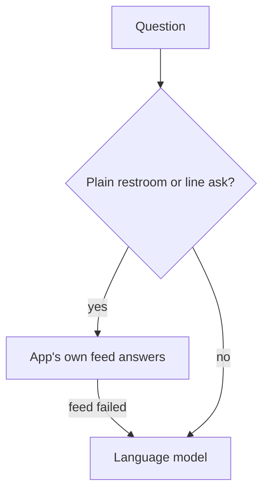

# PR #573: feat(agent): answer plain restroom and line questions before the model

- State: merged (2026-10-29)
- Opened by Pukujan on 2026-10-29
- Original: https://github.com/Pukujan-lab/nyc-map-agent/pull/573
- Branch `feat/answer-first-without-model` into `main`, +91 −8 in 6 files, merge commit 7eb6e939859f5961d538b8ec8d1fe18ada9b9b11

**Problem:** every question goes to the language model, even the two the home buttons send most ("Where's the nearest public restroom that's open now?", "How is the 7 train running right now?"). These have one right answer from the app's own data, yet they wait on a model round trip that is slow on the live site and sometimes fails. The no-model answers already existed (#199), but ran only after the model failed or the daily budget ran out.

**What changes**
- New `fastIntent` in `server/features/agent/noModel.ts`: a narrow matcher for plain English restroom and single-line status questions. Every word must be a known filler word, a restroom word, or one subway route; anything else (a place name, "on the way", "or", another language) returns null.
- `POST /api/agent` runs it first. On a match it answers through the same tools the model would call, so the map commands, buttons under the answer and the sources line are the same. It ends with `done` and `model: "none"`, no tokens.
- On no match, or if the feed fails, the request goes to the model exactly as before.

- Plain restroom or line question → app's own feed answers (no model).
- Feed failed, or anything else → the language model, as before.

**How to verify:** unit tests cover what matches (the home buttons' English questions, short asks) and what does not ("nearest public restroom to Bryant Park", "is the 7 running to Flushing?", "is there a delay", Spanish). A route test checks a plain line question makes zero model calls, and a longer one still calls the model. Three model-path tests now ask a restroom question with an extra detail so they keep testing the model path. All 221 agent tests pass.

**Unchanged:** other languages, trips, exits and every other question still go to the model. Budget fallback is unchanged.

Step 1 of making common answers deterministic; exits and two-ended trips are next.

🤖 Generated with [Claude Code](https://claude.com/claude-code)
