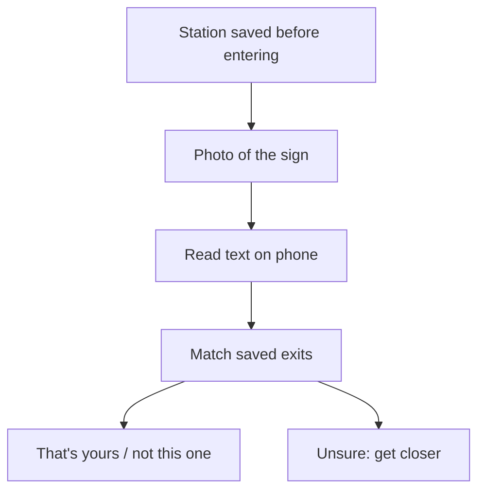

# Issue #587: Exit help: read the exit sign with the camera, offline, and say whether it's yours

- State: open
- Opened by Pukujan on 2026-10-29
- Original: https://github.com/Pukujan-lab/nyc-map-agent/issues/587
- Labels: account:unrecognized, authorization:claimed, exposure:active-production, filer:human-via-agent, evidence:supported, likelihood:observed, needs-human-verification, impact:moderate, needs-priority-definition, observational-issue, ontology:oio-1.1.0, ontology:project-1.0.0, proposal, queue:class-3, queue:class-3:account-99, recoverability:documented-recovery, relation:related, release:affects, review:product-outcome-review, status:open, type:observational

### Summary

Underground, the app knows the right exit but the rider still has to match its name against the signs on the wall. The idea: one photo of the sign, read on the phone without signal, compared with the station's saved exits, then "That's your exit" or "Not this one". An idea to test first, not to build yet; the owner has been researching live camera recognition separately.

### Identity and Lineage

- Leaf issue: this one
- Parent: none
- Task/branch: none yet

### Acceptance Criteria

- [ ] The feasibility test (H1) is run and its result recorded (proposed)
- [ ] A build decision is made from that result (proposed)

### Boundaries and Next Action

Out of scope: live video, cloud AI underground, building before the test.
Next action: collect about 15 photos of NYC exit signs (taken by the owner, or from open photo sources) and run the offline text reader on them.

### Symptoms

1. **The exit is hard to confirm on the spot.** Exit help picks the right exit from data saved on the phone, but the rider must match the name against wall signs.
2. **The current help is typed.** The underground "Describe what you see" box (`src/features/underground/Underground.tsx`) asks the rider to type what the signs say; it waits for signal.
3. **Cloud camera AI fails where it's needed.** Live camera assistants (Gemini Live, GPT Realtime, Meta's glasses) send frames to a server, and stations usually have no signal.

### Hypotheses (unverified)

- (hypothesis) H1: a phone can read NYC exit signs offline well enough to match one exit.
  Experiment to confirm: run the open-source in-browser reader Tesseract.js on this Mac over about 15 sign photos (normal light, at an angle, from a distance) and count correct matches. Refuted if most come back garbled or match the wrong exit.
- (hypothesis) H2: the reader is small and fast enough to save with the station.
  Experiment to confirm: measure download size and the time to read one photo on a mid-range phone.

### Counter-signal

Built-in browser text detection is not available on iPhones, so the reader has to ship with the app; dim station lighting is a known weak case for text readers.

### Honest Caveat

Nothing has been measured. A wrong "that's yours" is worse than no answer, so a match must only be stated when it is clear. Signs that list several exits may need the arrow worked out, which this does not yet address.

### Problems vs Gaps

- Problem (evidenced): confirming the exit relies on reading signs and typing.
- Gap (untested): whether offline sign reading is accurate enough (H1, H2).

### Issue Type

observational

### Lifecycle Status

open

### Filer Origin (who initiated this filing)

human-via-agent

### Filing Authorization Evidence

claimed

### Session, Authorization Evidence, and Instruction Reference

- Session reference: Claude Code session, 2026-10-29
- Claimed instruction/source: the owner asked for issue logs to track these ideas ("write issue logs to track all of these")
- Authorization evidence: claimed. The GitHub account is shared with the agent session, so this does not prove who typed the instruction.

### Content Author Account or Runtime Identity

agent:claude/claude-code-session-2026-10-29

### Directing Human GitHub Account ID

137629468

### Destination Repository

Pukujan/nyc-map-agent

### Ontology Versions Used

oio=1.1.0; project=1.0.0

### Project Priority Path

unresolved (the project's priority paths still carry generic meanings)

### Project Priority Concept ID

unresolved

### Affected App, Adopter, Users, or Systems

Riders using underground exit help, most of all those who don't read English easily.

### Observed Consequence and Workaround

The right exit is known but hard to confirm. Workaround: read the signs and use "Describe what you see".

### Evidence Confidence

supported

### Impact if Unresolved

moderate

### Likelihood

observed

### Exposure

active-production

### Exposure Duration

since the feature area shipped; ongoing

### Recoverability

documented-recovery

### Recovery Evidence

A rider who takes the wrong exit is re-routed from the exit they used (wrong-exit re-plan, PR #564).

### Risk if the Observation Remains Unresolved

Riders keep going up the wrong stairs and walking around the block, which the app then has to correct.

### Risk Introduced by a Proposed Change

Moderate. A wrong match sends someone up the wrong stairs; unclear matches must not be shown as certain. Photos must stay on the phone.

### Product or Release Relevance

affects

### Named Product Outcome and Cost of Delay

Core job "Underground and exits". Delay keeps the typed workaround.

### Cost of Delay

Low; the feasibility test is cheap and independent.

### Smallest Useful Product Slice

The photo fills the existing "Describe what you see" box, read offline.

### Provenance and Context

- Destination repository: Pukujan/nyc-map-agent
- Source revision/environment: main at the time of filing; live site https://nyc.design-bakery.com
- Ontology versions: OIO 1.1.0 / project 1.0.0

### Reproducibility Steps and Evidence

1. Open exit help for a station underground.
2. Look for a way to confirm the sign in front of you.
Observed result: only a typed description box.

### Issue Relations

related: #373
related: #532
related: #192
related: #586

### Citations and References

- Owner discussion in a Claude Code session, 2026-10-29
- Owner's research notes on live camera recognition (separate research repository, 2026-10-28)
- Tesseract.js: https://github.com/naptha/tesseract.js

### Non-Binding Proposed Next Actions

*(proposal)*

1. Save the station before entering (already done: exits with names and corners).
2. Take one photo of the sign, not live video.
3. Read its text on the phone, offline.
4. Compare the words with the saved exits without AI, tolerating "Av"/"Ave" and "NE"/"northeast".
5. Answer plainly; when the reading is weak, say "Get a little closer" instead of guessing.

In words: the station is saved before entering; the rider photographs a sign; the phone reads it; the text is matched against the saved exits; the app answers, or asks the rider to get closer when unsure. With signal above ground, a cloud model could add more, as an extra only.
