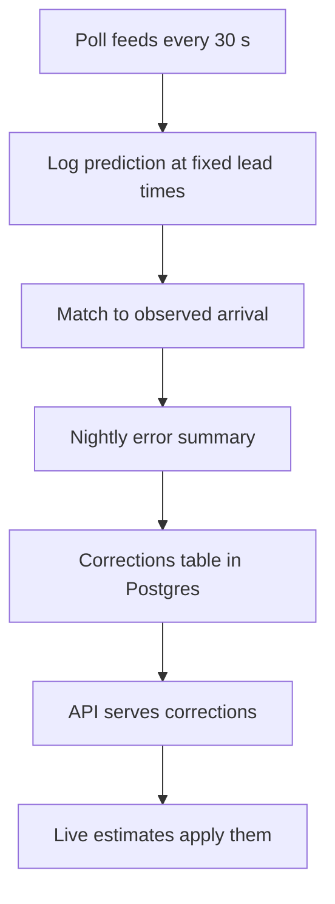

# Issue #594: [ISSUE]: Transit estimates cannot get more accurate because we never record how wrong they were

- State: open
- Opened by Pukujan on 2026-10-30
- Original: https://github.com/Pukujan-lab/nyc-map-agent/issues/594
- Labels: account:unrecognized, filer:human-via-agent, needs-human-verification, needs-priority-definition, observational-issue, ontology:oio-1.1.0, ontology:project-1.0.0, proposal, queue:class-3, queue:class-3:account-99, relation:related, status:open, type:observational, needs-filer-stamp, needs-impact-evidence, needs-release-relevance

### Summary

The map draws estimated train and bus positions, and the app already learns typical travel times from the MTA's live data. But nothing records how far off an estimate turned out to be, so nobody can tell whether the learning helps, which routes are worst, or which setting to change. The learned times are also recorded only about 1–1.5 hours a day, so most hours of the week have no history at all.

### Symptoms

1. **No error record.** For any train or bus we can say what we showed, but not whether it was early or late. Nothing in `server/features/transit/` or `scripts/transit-observe.ts` stores a prediction next to its outcome.
2. **Thin history.** The recorder is scheduled every 15 minutes but GitHub starts it 4–7 times a day (counted from the last 200 runs; 13-minute runs), so an hour of the week needs several weeks to collect the 3 subway samples (2 for buses) the app requires before using it.
3. **Fixed blend settings.** How much the map trusts the live feed versus history for a subway stop is a fixed formula (`liveWeight` in `src/features/transit/history.ts`: 0.9 near, down to 0.4 at about 20 minutes out). It was never tuned against outcomes.
4. **No wait-time number.** We do not compute the gap between trains or buses at a stop, so "average wait" cannot be answered.
5. **Subway "actual" is the feed's own last guess.** `server/features/transit/observe.ts` takes the last predicted arrival before a stop disappears from the feed as what happened. That is a weak ground truth.

### Hypotheses (unverified)

**H1. Blending history beats the raw feed for stops more than about 10 minutes out.**
Status: unverified. Would confirm: across many trips, blended error at long lead times is smaller than raw-feed error. Would refute: errors are equal or the blend is worse. Experiment: log raw and blended predictions at fixed lead times (see Proposal) and compare after two weeks of data.

**H2. Some routes or hours are much worse than average, and a per-route correction would help.**
Status: unverified. Would confirm: error differs strongly by route and hour. Would refute: error is uniform. Experiment: group logged errors by route, direction and hour of the week.

**H3. Buses stopped away from a stop mostly mark time lost at traffic lights.**
Status: unverified. Would confirm: stationary periods far from any stop cluster at known signalized corners. Would refute: they cluster at stops or random places. Experiment: log stationary GPS runs not at a stop and check them against intersections. No public signal-timing feed is known to us; this is a stand-in.

### Evidence

- Recorder cadence: the `transit-observe` workflow succeeded in every one of its last 8 runs (about 13.6 minutes each) but ran only 4–7 times per day from 2026-10-22 to 2026-10-29. This supports symptom 2.
- Volume per run (last 6 runs): 685–3,327 subway observations and 3,419–20,668 bus observations. These are segment travel and stop-time observations, not predictions. Counter-signal: that is plenty per run; the shortage is coverage across hours of the week, not per-run volume.
- Code facts checked: the bus feed read in `loadBuses` carries positions only, with no arrival predictions; bus motion is estimated by dead-reckoning in `src/features/transit/busEstimate.ts`; subway blending happens in the browser (`src/features/transit/model.ts`, `blendStops`).
- Not verified: how many rows are currently stored, because the project's Octo credentials exist only as a GitHub secret and could not be read from this machine.

### Honest caveat

For the subway, a better ground truth likely needs the feed's vehicle "stopped at" signal, which this draft has not checked. Improvements measured against the feed's own last guess can only show the app drifting toward the feed, not toward reality.

### Problems vs gaps

- Problem: history is recorded too rarely to cover the week (symptom 2).
- Gaps: no prediction-vs-outcome record (1), no tuned blend (3), no wait-time number (4), no weak-truth fix (5).

### Proposal *(proposal; none of this exists yet)*

Build it on Octo's existing Postgres database now, so data starts accumulating, and move the heavy summaries to Octo's DuckDB layer later if Octo gains workspace-defined queries.

1. **Prediction log.** Extend the recorder to save, for each upcoming subway stop, the raw feed time and our blended time when the stop is about 15, 10, 5 and 2 minutes away. Table `raw.transit_prediction_obs`. For buses, save the dead-reckoned position error in metres against each next GPS fix.
2. **Outcome match.** When the stop drops off the feed, record the observed time (existing logic) and the error at each lead time. Keep 60 days.
3. **Summaries.** A nightly job writes error by route, direction, stop pair, hour of the week and lead time; also gap between consecutive trains or buses at a stop (wait time). Plain SQL in `marts`, in the same style as `marts.transit_segment_hourly`.
4. **Use them.** A small endpoint (like `/api/transit-segments`) serves per-route corrections and tuned blend weights. `blendStops` and `busEstimate` read them, falling back to today's behavior when absent.
5. **Record all day.** Replace the 4–7-per-day GitHub schedule with an always-on recorder on a machine you choose. This is a decision for the owner: gravebuster is the current runner host but is separate from the Precedent deploy; the MacBook Pro is the standard deploy target. Not decided.
6. **Octo follow-up.** When Octo supports workspace-defined analytics queries and appendable datasets (Pukujan/octo-database#341), move step 3 there.

### Acceptance criteria

- A report shows average and 80th-percentile error for subway arrivals at 15, 10, 5 and 2 minutes ahead, for raw and blended predictions, by route.
- The same report shows bus position error by route and hour of the week.
- A wait-time figure exists per stop and hour of the week.
- Over two weeks, at least 80% of weekday hours (6 am – 10 pm) for the main routes have enough samples to be used.
- The map's behavior is unchanged when corrections are missing.

### Boundaries and next action

Out of scope: traffic-signal data, Octo changes, changes to what the map shows to people. Next action: owner reviews this draft, picks the recorder host (step 5), and says whether and where to file it.

### Not decided here

Where the always-on recorder runs (gravebuster, whose disk is 97% full, or the MacBook Pro, whose disk was 99% full before a cleanup); the project priority path.

### Issue Type

observational

### Lifecycle Status

open

### Filer Origin (who initiated this filing)

human-via-agent

### Filing Authorization Evidence

claimed. The owner asked for this plan and, on 2026-10-30, directed filing it with the Octo issues ("Go lets file those issue log", then "Ok" to a message naming the destinations). No oio-auth attestation yet.

### Destination Repository

Pukujan/nyc-map-agent

### Ontology Versions Used

oio=1.1.0; project=1.0.0

### Project Priority Path

unassigned (the project's paths 1-100 are still generic placeholders)

### Issue Relations

related: Pukujan/octo-database#340
related: Pukujan/octo-database#341

